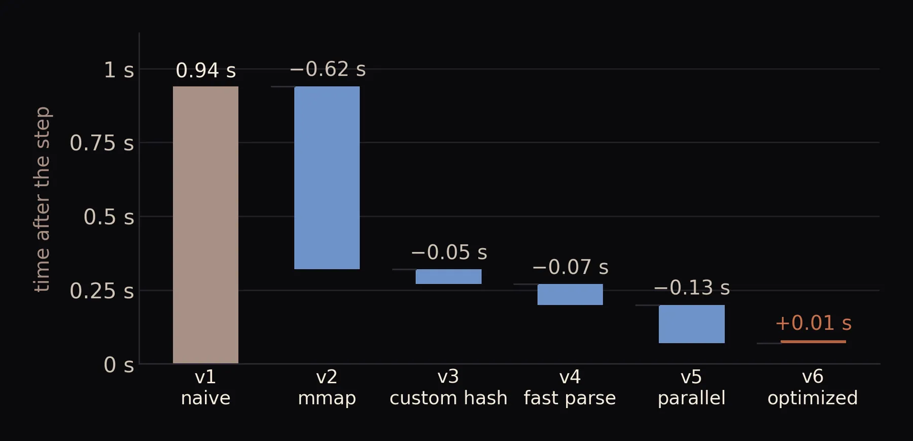

## What it is

A Bazel workspace holding one data generator and six complete answers to the same problem, each in a single file under `src/`. `v1_naive.cpp` is 49 lines; `v6_optimized.cpp` is 287. Nothing is shared between them except `src/common.hpp`, which is the point: no version can hide behind a refactor.

The problem is the One Billion Row Challenge. A file of `station;temperature` lines — thirteen gigabytes for a billion rows — has to be reduced to the minimum, mean and maximum temperature for each of the 160 station names, printed in one sorted line. The cost is turning text into integers a billion times without touching the heap more often than necessary. The repository's arrangement turns that into a ladder: six versions, each changing one thing, labelled by the README's own diagram — mmap 3×, custom hashmap 1.2×, integer parsing 1.4×, threads 3×.

<figure class="ladder" data-motion="figure">
  
  <figcaption>The README's benchmark table, ten million rows on sixteen cores, drawn as the ladder the repository is arranged around: one change per version. <code>run_benchmark.sh</code> produced these numbers with <code>time -p</code> and they are not reproduced in CI. The last bar is the interesting one — <code>v6_optimized</code> is slower than the <code>v5_parallel</code> it was meant to improve on.</figcaption>
</figure>

## How it works

`src/common.hpp` fixes the data model for every version. `brc::Stats` holds `min`, `max`, `sum` and `count` as `int64_t`, and a temperature is stored as the integer tenths of a degree — `-12.3` is `-123` — so the hot loop never calls `stod` and never sees a float. `update` and `merge` are the only two mutations. `output_results` does the conversion back to one decimal place via `format_temp` and walks the stations in sorted order.

`v2_mmap.cpp` replaces `std::ifstream` with `mmap` and scans for the `;` and `\n` bytes by hand. `v3_custom_hash.cpp` replaces `std::unordered_map` with a fixed open-addressed table: `MAP_SIZE` is 16384 and a power of two, and `find_or_create` hashes with FNV-1a, masks with `MAP_SIZE - 1`, compares length before `memcmp`, and probes forward on collision. `v4_fast_parse.cpp` folds the hash into the name scan and parses the temperature from digit bytes alone.

`v5_parallel.cpp` is where the shape of the program changes. It maps the file, calls `madvise(MADV_SEQUENTIAL)`, divides it into `num_threads` slices — `std::thread::hardware_concurrency()` unless the second argument overrides it — and then walks each boundary forward to the next newline with `find_newline`, so no row is split between threads. Each thread owns a private `HashMap` with no locking; the maps are merged after `join`.

`v6_optimized.cpp` tightens the per-row work instead of the program's shape: `struct alignas(64) Entry` puts one record on a cache line, `scan_name_and_hash` unrolls four bytes at a time around a multiply-xor hash and finishes with `hash ^ (hash >> 33)` so the table index arrives with the name, and name comparison reads eight bytes per iteration.

## Run it

From the README and `run_benchmark.sh`:

```bash
bazel build //...

./bazel-bin/generate_data 1000000000 measurements.txt
./bazel-bin/v5_parallel measurements.txt

./run_benchmark.sh 10000000 3
```

The toolchain is pinned in `.bazelrc`: C++20, and a default `--config=opt` of `-O3 -march=native -mtune=native` plus link-time optimization. `MODULE.bazel` pins `rules_cc` 0.0.9 and `platforms` 0.0.10. The benchmark script takes a row count and a repeat count, builds the six binaries, generates the input if absent, and times each run with `time -p`, averaging with `bc`.

## Caveats

The code is POSIX-only. Every version past the first includes `sys/mman.h` and `unistd.h`, and `open`/`fstat`/`mmap`/`munmap` are called directly, so the workspace does not build on Windows.

<figure>
  
  <figcaption>The same table read as marginal savings rather than totals. Almost all of the win sits in two steps — mapping the file instead of streaming it, and splitting it across threads — and the sixth step gives back a hundredth of a second. That last bar is why the caveats here treat the ordering as the claim and the numbers as an anecdote.</figcaption>
</figure>

The README's benchmark table is one set of numbers from one machine — 10M rows, 16 cores — never reproduced in CI, because there is none. Treat the ordering as the claim and the figures as an anecdote. The table also undercuts its own ending: `v6_optimized` comes in at 0.08s against `v5_parallel` at 0.07s, so the last version is the slowest of the two parallel ones, and the two headers disagree about the machine they were measured on — `v6_optimized.cpp` predicts "~2s for 1B rows on 8 cores" while the README table says 16.

Two smaller limits are visible in the source. `parse_temp_branchless` is named for a property it does not have: it branches on whether the byte after the first digit is a `.`, and picks between a three-character and a five-character parse. And both fixed tables size the station set at 16384 slots for names of at most 100 or 104 bytes; the probing loop in `find_or_create` has no full-table exit, so more distinct stations than the table can hold would spin rather than report. `run_benchmark.sh` needs `bc` and ends with an interactive `read -p` prompt asking whether to delete the generated data file.
