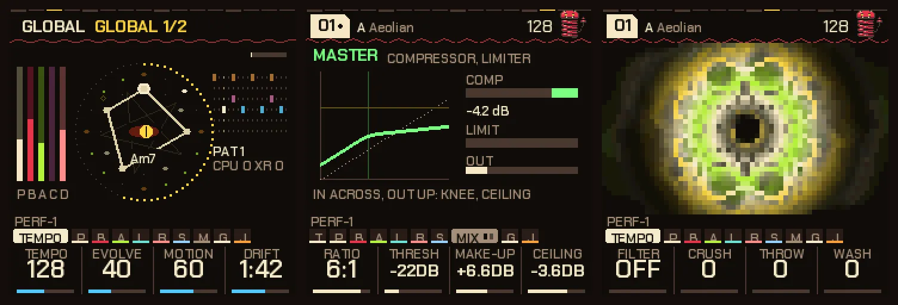
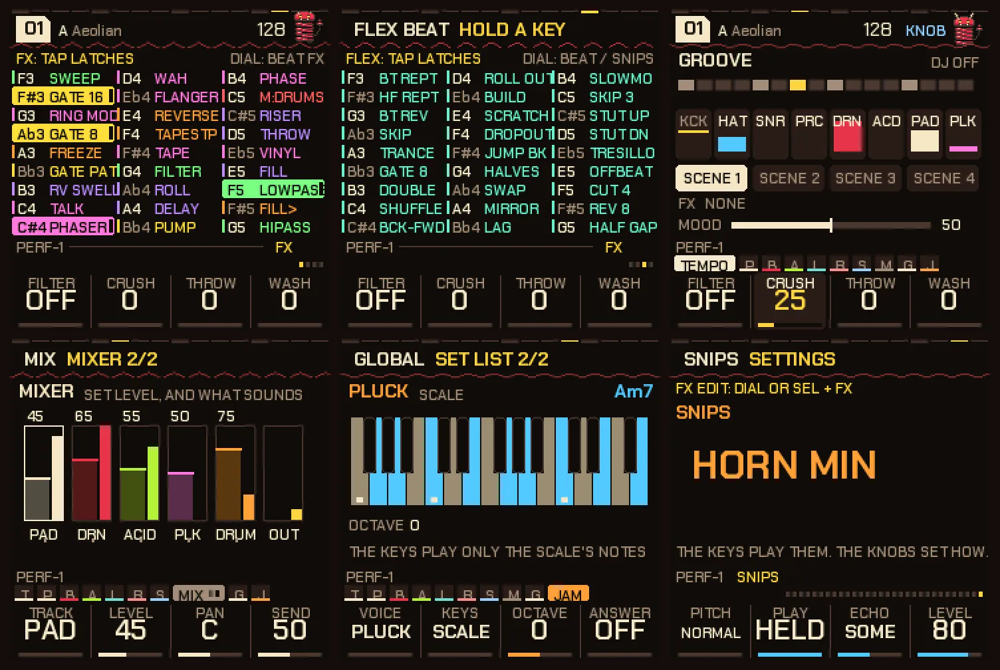

## What it is

NAIWAN 91 turns an M-VAVE FM-1 — a small FM groovebox built on a JieLi AC79 chip — into a backing band for three jazz standards: Blue Bossa, Autumn Leaves and Satin Doll. The player picks a standard, sets a key and a tempo, and the instrument comps: drums, a bass line, and a keyboard part that follows the written changes, with the program and the reverb changeable while it plays. Six keyboard sounds and two bass sounds can be swapped while it plays, and Synth Jam hands all 27 keys to the player while the drums and bass carry on. The same instrument also runs in a browser, as a WebAssembly build of the firmware.

<figure>
  
  <figcaption>Framebuffer captures of the home screen's chord circle, the master bus and a kaleidoscope visualizer, cut by <code>tools/make_screenshots.py</code> from the simulator's output.</figcaption>
</figure>

The problem is familiar. The stock firmware is a binary, the chip is documented mostly by hobbyist reverse engineering, and nothing about how the instrument decides what to play can be changed. NAIWAN 91 keeps the engine, the screen, the flash layout, the USB installer, the browser emulator and the release evidence in one tree that builds from source, so a change to the chord policy or the reverb is something the owner can make and test.

## How it works

The DSP is one C translation unit. `firmware/src/dsp/amb.c` is about 10,000 lines and compiles at `-O2` as a single object; the six-operator FM engine sits beside it in `fm6.inc` and `fm6_core.inc`, and the DX7 voices are generated into `fm6_dy.h` by `tools/gen_fm6_dy.py` from DX7 bank files that are not in the tree. The page walk and knob handling are `firmware/src/app/ui.c`, around 8,800 lines.

Storage is the interesting part. `firmware/src/app/project.c` packs each piece into a fixed 376-byte record — `IMG_REC` — inside one flash object per genre, so a setting can be added later without moving the records already written, and an older record loads with the piece's recipe for whatever is missing. A save costs about 22 ms of silence, which the UI fades around.

Musical decisions are moving out of C into Rust crates under `rust/`; the engine crate `rust/fm1-engine` is `no_std` and forbids unsafe code. `rust/fm1-engine/src/planner.rs` plans the accompaniment through `plan_into` and `bass_event`, and its doc comment is explicit that candidate order and random-call order are musical behaviour: the same seed has to produce the same phrase. The C engine reaches those kernels through the `rust_*.h` bridges in `firmware/src/dsp/`. The browser player is the same code compiled for wasm32, with `web/emu/src/` handling audio, MIDI, storage and the panel.

<figure>
  
  <figcaption>Six pages of one interface, captured from the simulator: FX, the flex bank, the performance screen, the mixer, Synth Jam and the sampler.</figcaption>
</figure>

## Run it

`BUILDING.md` pins the toolchain: Python 3.10 or newer with Pillow, JieLi clang 4.0.1 for pi32v2, and Rust 1.94.1 with the `wasm32-unknown-unknown` target. The JieLi toolchain is Linux x86-64 only. Three files of the AC79 SDK are not redistributed here, so it is cloned separately:

```sh
git clone --depth 1 --branch AC79NN_SDK_V1.2.1_2023-12-13 https://gitee.com/Jieli-Tech/fw-AC79_AIoT_SDK.git ~/fw-AC79_AIoT_SDK
tools/get_toolchain.sh
rustup toolchain install 1.94.1 --profile minimal --target wasm32-unknown-unknown
rustup override set 1.94.1
```

A release build produces the firmware package, the loader and the emulator; the site is a second command:

```sh
tools/release.sh 0.4.4
python3 tools/make_pages_site.py 0.4.4 build/site
```

`./build.sh` alone makes a development build stamped `DEV`, and `tests/run_tests.sh` runs the checks by themselves: the maths library against libm, the SysEx and flash code, the dual-core handoff, and the whole app in a simulator over the 94 `.amb` scripts in `tests/scenarios/`. The browser player is live at [superposition.github.io/91/emu/](https://superposition.github.io/91/emu/).

## Caveats

`BUILDING.md` states plainly that a successful build is not a hardware qualification, and the 0.4.4 record agrees: `docs/release/hardware-0.4.4.json` documents one unit, `FM-1_7000404`, over 129 frames and 32 seconds of playback, with no xruns. One instrument, half a minute.

The write path is guarded but not fully proven. The installer's identity, CRC and read-back checks and the firmware's two-failed-boots safe mode cover a bad app. They do not cover a corrupt start-up sector, a bad secondary loader, or power lost mid-write — the repository says the interrupted-write safety is by design, not tested with a power cut — and no hardware recovery method for this chip has been demonstrated, so a stock firmware image has to stay within reach.

The firmware is a fork of PERF-1 by deamonSLINKY, downstream of HYP-1 and AMB-1, and is GPL-3.0-only; the browser build inherits the licence.
