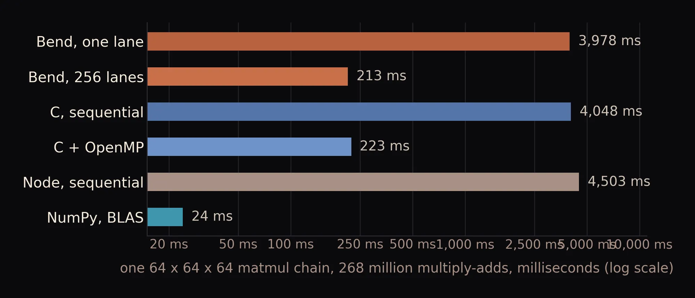
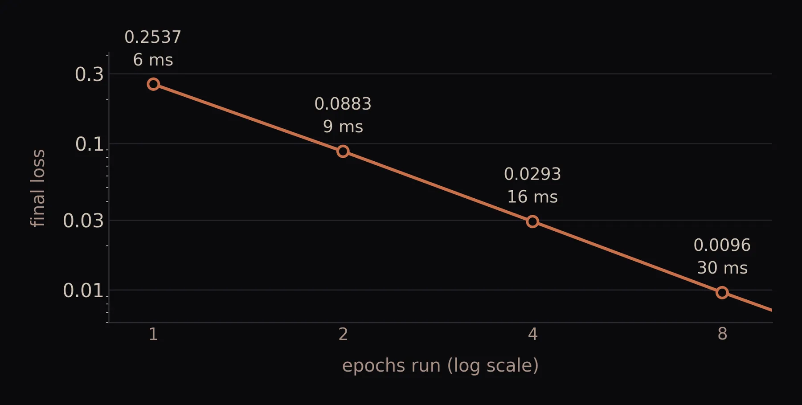
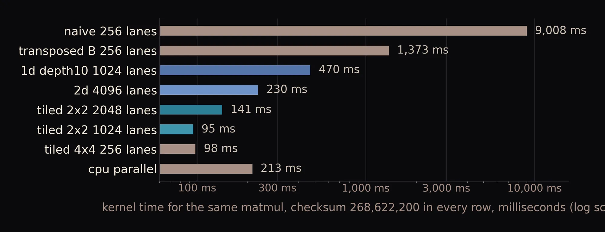

## What it is

bend-ml-lab is a measurement notebook for one language. It holds small numeric programs written in
Bend 2 — a matrix-multiply family, a training loop, and a weight-analysis script — each paired with a
C, Node, or NumPy twin that runs the same loop order, plus each run's CSV. The entry points are
`bench/einsum/`, `train/`, and `wsp/`, and every README table comes from a script in the repository
that rewrites its own output file.

<figure>
  
  <figcaption>One matmul chain of 268 million multiply-adds, timed by <code>bench/einsum/run.sh</code> and committed to <code>bench/einsum/results.csv</code>, one run each on the repository's 32-vCPU machine. Every run reports the same checksum, so the bars differ by speed and not by work done: sequential Bend sits beside sequential C and Node, and the 256-lane Bend run lands beside OpenMP C at 213 ms against 223. NumPy's BLAS routine is the outlier at 24 ms and is not a like-for-like loop.</figcaption>
</figure>

A compiler release tells you what it promises, not what a dense `F32` loop costs on your machine. Bend 2 is new — the README calls the 2.x line roughly ten weeks old — so the repository settles it
by building the same work three ways and timing it. `ROADMAP.md` states the acceptance rule plainly:
an experiment closes when its measurement is committed, not when the preferred hypothesis wins, and a
negative result is a result. Its closing table reports 12 experiments done, 3 negative, 2 blocked on
tools the machine did not have.

## How it works

Bend has no tensor type and no `einsum`, so `src/tensor.bend` builds both. Storage is a single
`Array<F32>` padded to a power of two, because an `Array<T>` in Bend is a `Type` with exactly one
owner and every read hands the array back; shapes travel beside it as `U32` values. On top of that sit
`dot`, `mm`, `mm_tn`, `outer`, `vdot` and `rowsum`, plus a `csum` checksum every benchmark prints
so a faster number cannot come from doing less work. Input data is deterministic: an xorshift32
generator with the constants from Bend's own nbody benchmark.

Parallelism lives in a separate module on purpose. `src/parallel.bend` is the only `@unsafe` file,
because `Array.fork` hands two aliases of one array to two lanes; `tree` splits the output by rows,
each lane writes a disjoint band, and `Array.join` merges the handles. Keeping it separate
is what lets the safe core pass `bend --check-only` with no unsafe defs in the report.
`src/mlp.bend` takes the opposite tack for the trainer: the model is a record of four `List<&2, F32>`
fields, which are `Data` and therefore copyable, so a gradient step rebuilds lists instead of
mutating shared memory. `train/epoch_sweep.sh` rewrites the epoch count into a scratch copy of the
trainer for 1, 2, 4 … 64.
`bench/einsum/run.sh` compiles the Bend binary and its
gcc, OpenMP, Node and NumPy twins and writes `bench/einsum/results.csv`.

<figure>
  
  <figcaption>The trainer's own sweep, from <code>train/epochs.csv</code>: <code>train/epoch_sweep.sh</code> rewrites the epoch count into a scratch copy of the trainer and records the final loss and the wall clock of each run. Loss falls roughly with the square root of the epoch count while the time grows linearly, which is the shape this toy trainer was built to expose rather than to beat.</figcaption>
</figure>

## Run it

The README's quickstart targets WSL2 and pins Bend 2.0.40 (also what CI installs):

```bash
curl -fsSL https://bend-lang.com/install.sh | sh
export PATH="$HOME/.bend/bin:$HOME/bin:$PATH"
ln -sf /usr/bin/clang-21 "$HOME/bin/clang"   # any clang 14+; 19+ for `!`

cd bend-ml-lab
bend src/tensor.bend --check-only
bend src/parallel.bend --check-only
bend train/main.bend
bend wsp/analyze.bend
```

Native runs and the drivers:

```bash
bend bench/einsum/main.bend -o /tmp/bend_einsum
/tmp/bend_einsum
bash bench/einsum/run.sh
bash train/epoch_sweep.sh
```

CI runs `bend PROOF.bend` and the fuzz and kernel-contract tests under Bend 2.0.40 on `ubuntu-22.04`;
a second job checks the same proof through Lean 4.34.0 with `--verdict`.

## Caveats

The numbers are one run each from the repository's own hardware — WSL2 Ubuntu 22.04, 32 vCPU, an RTX
4090, clang 21.1.8 — and the README says repeated Bend and C runs varied by up to about 10%. The GPU
results depend on a patched compiler: the 4090 reports `concurrentManagedAccess=0` under WSL2, so
Bend refuses the GPU lane until `tools/wsl2-gpu.patch` relaxes the guard, and the README marks that
path unsupported. Native Linux is the supported host; there is no Windows target.

<figure>
  
  <figcaption>The same matmul as a GPU kernel, six ways, from <code>bench/einsum/gpu.csv</code>, with the checksum identical in every row. Transposing B turned strided reads into contiguous ones and took 9.0 s to 1.4 s; giving each lane a row, then a 2x2 tile of rows, took it to 141 ms and then 95 ms. The kernel never changed its arithmetic, only what each lane touched and how much of it was in flight.</figcaption>
</figure>

The einsum work is a lowering, not an engine. `docs/einsum.md` says there is no runtime contraction
engine on purpose: an equation picks one specialised kernel. Its table still marks batched contraction
and the plain transpose as unimplemented, though `src/tensor.bend` carries a `transpose` and a
`matmul_bt`; the toy trainer uses per-sample scalar loops either way. The weight-space section is a set of
directional sensitivities on a 2-2-8-4 model after 20 epochs; the README states that these are not a
capability result and not a replication of any published edit, and `docs/wsp.md` explains why the judge
must be the serving engine, not Bend.

One README claim has gone stale. Finding 9 says there are no laws yet, but `LAWS.bend` now states
one — setting index `n` of a list and reading it back returns the value — and `PROOF.bend` proves it,
which CI checks.
