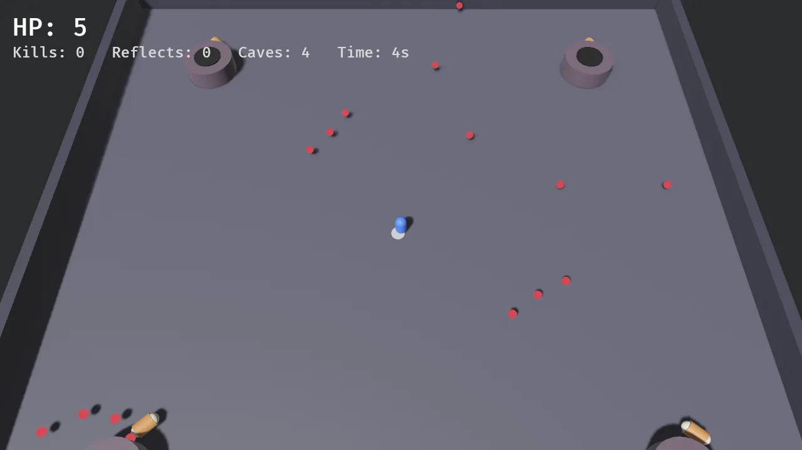
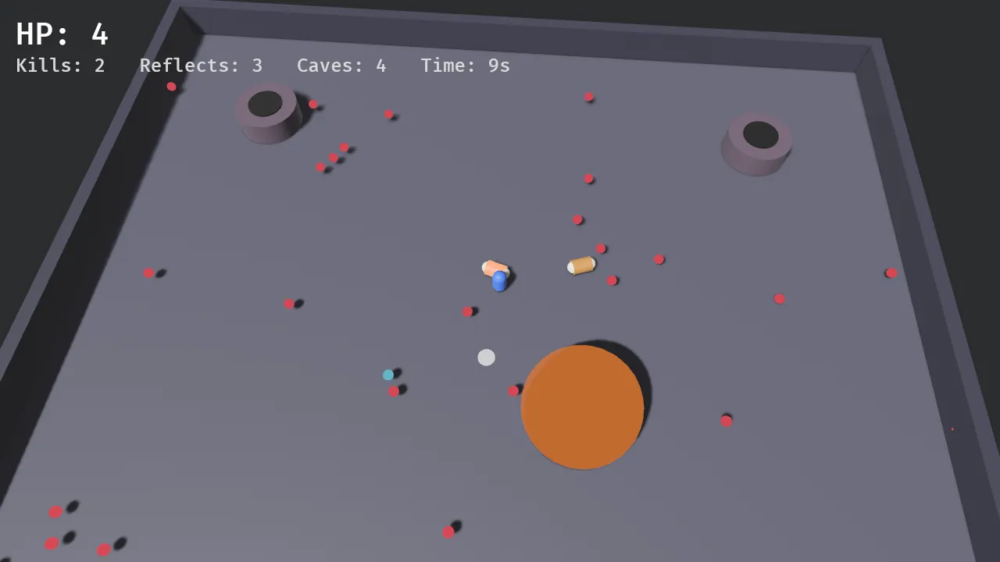

## What it is

Cannoli Hell is a small 3D arena shooter. The player controls a blue capsule in a walled square hall, aiming with a mouse-cast onto the floor, dashing with the space bar, and throwing punches with the left mouse button. Four rock caves sit at the corners of the arena. They give birth to cannolis that walk toward the player, light a fuse, and explode, and they fire bullet patterns that can be punched back into them. Destroy all four caves and the run ends in a victory screen; run out of health and it ends in a game-over screen.

The game ships twice from one Cargo package: a native Bevy window, and a WebAssembly bundle committed to `docs/` that a browser loads. What makes it worth reading is the loop: a complete arcade loop — state machine, physics, spawning, difficulty ramp, audio, HUD — with no texture pipeline at all. Every model is a Bevy primitive assembled at runtime, so the only binary art assets are `.ogg` sound files.

<figure>
  
  <figcaption>The opening of a run, four seconds in: HP 5, Kills 0, Caves 4. The four corner caves are the bosses, each with ten hit points and three firing patterns, and destroying the last one ends the run on the victory screen. Same build, same window, a few seconds earlier.</figcaption>
</figure>


<figure>
  
  <figcaption>A 1280×720 native window about nine seconds into a run: the blue capsule at the centre, cannolis and their bullets around it, and the stats line from <code>src/game/hud.rs</code> reading HP 4, Time 9 s, Kills 2, Reflects 3, Caves 4. The build came from this tree with <code>cargo build --release</code>; the frame was taken with <code>PrintWindow</code> from the game's own window, not from a screen grab.</figcaption>
</figure>

## How it works

`src/main.rs` is short: default Bevy plugins with `fit_canvas_to_parent` set on the window, the Rapier physics plugin, and two module plugins, `screens` and `game`. `src/screens/mod.rs` declares the state machine — `Splash`, `Title`, `Gameplay`, `GameOver`, `Victory` — and marks the enum `#[states(scoped_entities)]`, so every entity carrying a `StateScoped(Screen::Gameplay)` is despawned when the state leaves gameplay.

Gameplay is split into thirteen small modules under `src/game/`. `arena.rs` spawns the ground and four walls on entering `Gameplay`, with `ARENA_HALF` at 30 world units. `player.rs` spawns a blue capsule with `LockedAxes::ROTATION_LOCKED`, accelerates it to `PLAYER_MAX_SPEED` 12, and tracks five hit points behind a one-second invulnerability timer. `aim.rs` intersects the cursor ray with the y=0 plane and turns the player to face the result. `punch.rs` ties it together: a punch reaches 6 units inside a cone of 0.7 radians, applies an impulse of 60 on a 0.25-second cooldown, draws its arc from a generated ring-sector mesh, and calls `reflect_velocity` to send bullets back and increment `Score.reflects`.

`cannoli.rs` gives each pastry a chase speed and a `Fuse` timer that explodes it when it ends. `cave.rs` spawns the four bosses with ten hit points each and cycles one of three firing patterns — burst, ring, spiral — scaling them by `difficulty_at` in `score.rs`, which ramps four parameters from zero to one across 120 seconds and then holds them there. `audio.rs` loads five explosion, three swish, and four hit variants plus music tracks; `hud.rs` draws the health counter, a stats line, and a red damage overlay.

## Run it

There is no README and no scripts, so the only ready-to-run artifact is the committed browser build:

```sh
cd docs
python -m http.server 8000
```

Then open <http://127.0.0.1:8000/>. The native build type-checks with `cargo check` and runs as a desktop window:

```sh
cargo check
cargo run --release
```

`Cargo.toml` pins Bevy 0.16, `bevy_rapier3d` 0.30, and `rand` 0.8, and turns on LTO with a single codegen unit for release builds. The WebAssembly target needs `getrandom`'s `js` feature, which the manifest sets for `wasm32`.

## Caveats

Nothing describes how the `docs/` bundle was produced: there is no `wasm-bindgen` invocation, no `Trunk` or `wasm-pack` configuration, and no CI workflow, so the committed `.wasm` can drift from `src/`. The game carries twenty unit tests for aim, bullets, punching, and the difficulty curve, and no integration tests. Difficulty is a hand-written curve rather than a measured one, and the victory screen's own doc comment calls it a "stats placeholder". Play is mouse and keyboard only — there is no touch input and no settings screen. Loading the browser build also floods the console with Bevy `B0004` hierarchy warnings, one per entity with `InheritedVisibility` under a parent without it. Scores are session-only: the `Score` resource resets when gameplay starts.
