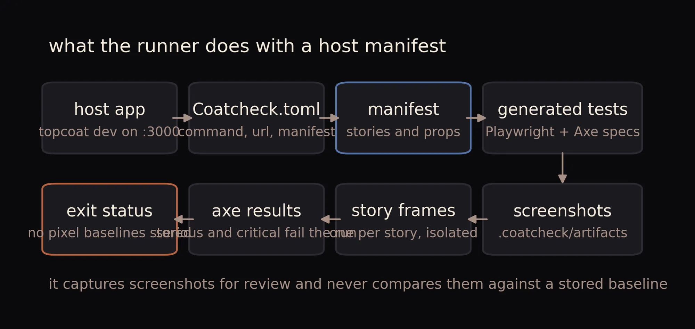
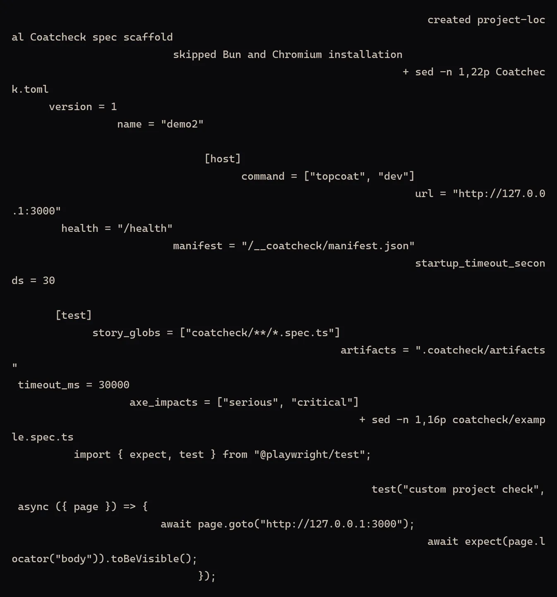

## What it is


<figure>
  
  <figcaption>The runner's job, from <code>docs/runner.md</code> and <code>docs/contracts.md</code>: read the host's manifest, generate Playwright and Axe tests from it, drive each story in isolation, write screenshots for review, fail the run on serious or critical accessibility findings — and never compare against a stored pixel baseline.</figcaption>
</figure>
Coatcheck is a Rust crate with an installable binary of the same name, aimed at component workbenches built on Topcoat. A project points it at its own workbench through a `Coatcheck.toml` — the command that starts the host, the URL to reach it, a health path and a manifest endpoint — and `coatcheck test` does the rest: start the host, wait for health, fetch the manifest, write one Playwright test per story and scene into `.coatcheck/generated`, run those tests alongside the project's own specs, and stop the host. Every case leaves a PNG, the rendered DOM, an Axe result and the captured console output.

The problem is that a workbench proves a component exists, not that it still works. Pixel baselines catch that, but they also fail on a font substitution or a different GPU, which is why teams stop trusting them. Coatcheck swaps the pixel comparison for assertions a browser can make about semantics and accessibility, and keeps the picture as review evidence rather than as the gate.

## How it works

Two layers sit in one crate. `src/lib.rs` is the static catalog: `Catalog`, `Story`, and `ArgType` with a `ControlKind` of text, number, choice, toggle, color or read-only, plus a `StoryKind` of playground, state, matrix, scene or documentation. It is const-friendly and allocation-free, so a host can declare its stories as a `&'static [Story]` table and call `Catalog::validate` at startup.

`src/contract.rs` is the running seam. `ManifestV1` carries a version, a name, a `FrameContractV1`, scenes and stories; `from_catalog` builds one from the static table. The frame contract is where the DOM conventions live: the frame path, the query names for story and scene, and three selectors — root, ready and error. `cases()` expands stories into story-and-scene pairs, and `validate()` refuses unsupported versions, duplicate or missing IDs, unknown scenes, invalid viewport dimensions and a frame contract with a blank field.

`src/config.rs` parses `Coatcheck.toml` with `deny_unknown_fields`, so a misspelled key fails instead of being ignored. `host.command` is an argument array executed directly rather than through a shell. `axe_impacts` defaults to serious and critical, which is the line between an accessibility regression and a style note.

<figure>
  
  <figcaption>What <code>coatcheck init</code> leaves behind in an empty project: a <code>Coatcheck.toml</code> naming the host command, the URL, the health and manifest paths, the story globs and the artifact directory, plus one Playwright spec to start from. Run with <code>--skip-install</code>, so Bun and Chromium were not fetched.</figcaption>
</figure>


`src/runner.rs` writes the generated runner. The Playwright config hard-codes one worker and one retry under CI, retains traces on failure, and points the HTML and JSON reporters into the artifacts directory; the generated spec bakes the three selectors in as constants and emits a `cases` array of titles, frame URLs, artifact slugs and viewports, then asserts navigation, the ready marker, the absence of the error marker, no uncaught page errors, no console errors, and the configured Axe impacts. `finish_review` writes the Markdown review index. `src/main.rs` is the four commands: `init`, `doctor`, `dev` and `test`, the last with `--no-host`, `--headed`, `--story` and `--slow-mo`.

## Run it

The crate is published as `coatcheck` 0.2.1. `rust-toolchain.toml` pins Rust 1.97.1 and the package declares `rust-version = "1.95"`, edition 2024.

```sh
cargo install coatcheck --locked
cargo install --path . --locked
```

In a project that hosts a workbench:

```sh
coatcheck init --package-manager bun
coatcheck doctor
coatcheck doctor --fix
coatcheck test
coatcheck test --no-host
coatcheck test --headed --story route-option --slow-mo 150
```

`init` writes `Coatcheck.toml`, a private `package.json` when the project has none, `coatcheck/example.spec.ts`, a `.coatcheck/` ignore entry, exact project-local `@playwright/test` and `@axe-core/playwright` versions, and Playwright's Chromium. `--skip-install` scaffolds offline.

## Caveats

The project describes itself as experimental, tracking Topcoat's early-stage development, and versions its manifest and frame contracts explicitly so a future schema can be added without breaking the 0.1 story model.

There are no pixel baselines: the PNGs exist for a human to look at, and pass or fail comes from the semantic and accessibility assertions alone. That means a visual regression that keeps the DOM valid and the Axe impacts below the configured threshold will pass the gate.

The generated runner is Chromium through Playwright with Bun as the package manager, so a project on another browser or a Node-only runner is outside what the tool has been exercised on. `Coatcheck.toml` is version 1 and rejects unknown keys; the manifest, by contrast, deliberately accepts unknown JSON fields so a producer can add metadata. `test` starts and stops the host itself; 0.2.1 narrowed the shutdown to the configured host process so a CI runner is not killed with it.
