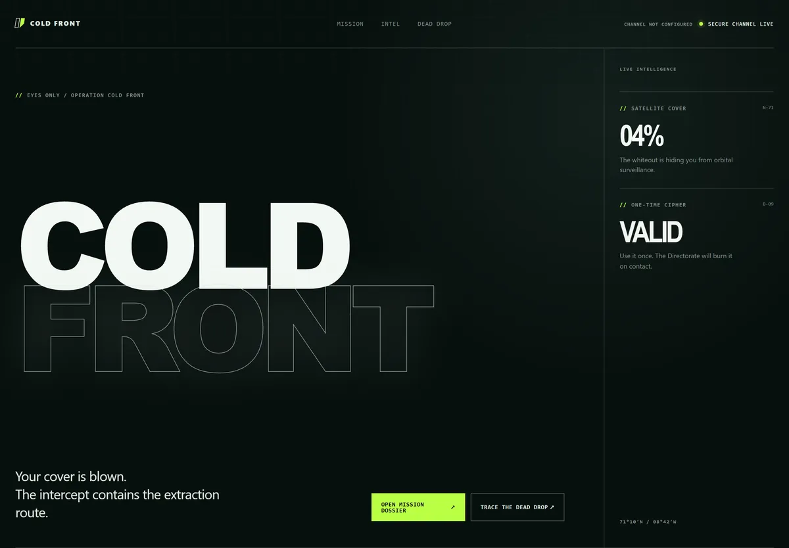
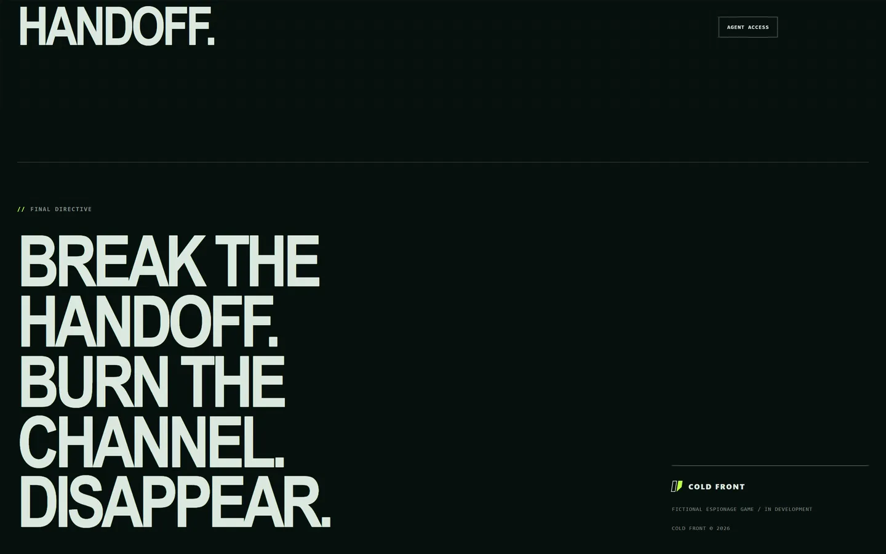

## What it is

Cold Front is a dark landing page for a fictional Arctic espionage mission. It opens on the words "COLD FRONT", an eyebrow reading "Eyes only / Operation Cold Front", and a rail of live-intelligence cards: satellite cover at 04%, a one-time cipher marked VALID, and the coordinates 71°10′N / 08°42′W. Below sits a three-part mission dossier about intercepting a courier, trusting nobody on the channel, and crossing before the sky clears. A Rust binary serves it on port 3100, and the same components render a second time, as a browsable catalog, on port 3101.

<figure>
  
  <figcaption>The static export in a 1440×1000 window; the chip at top right is the auth dock reporting an unconfigured Clerk application.</figcaption>
</figure>

<figure>
  
  <figcaption>The same page scrolled past the hero, at the deployed address rather than in a local window: three numbered mission cards, with the counterintelligence card carrying its own channel warning. The components are the ones in <code>crates/coldfront-ui</code> — the section is a template assembled from atoms and molecules, not bespoke markup for this page.</figcaption>
</figure>

The problem is familiar: marketing pages get assembled from one-off markup before there is anything to describe, and the visual language is never tested as a system. Here the site is the design system. Typed tokens, atomic components, a workbench with browser checks, and a static exporter all read from one crate, so a change is visible in the landing page, the catalog, and the exported Pages build at once.

## How it works

The repository is a Cargo workspace with four members: `apps/coldfront`, `crates/coldfront-ui`, `tools/coldfront-coatcheck`, and `tools/coldfront-static`. The public server is small. `apps/coldfront/src/main.rs` builds a router with a root layout, one page, and `GET /health`, which answers `coldfront:ok`.

The component crate carries the weight. `crates/coldfront-ui/src/tokens.rs` defines `DesignToken<K>`, holding a CSS custom-property name and value with a zero-sized marker family, so a color token and a spacing token are different types and a function can demand one. Families cover color, typography, spacing, radius, shadow, and motion, each with an `ALL` slice the workbench iterates. Above it, `atoms.rs` supplies the wordmark, eyebrow, signal chip, status badge, vital meter, and action link; `molecules.rs` adds `signal_card`, `dispatch_item`, `companion_card`, `resource_card`, `decision_card`, and `route_option`, with state enums that render stable `data-state` values; `organisms.rs` composes the header, hero, briefing grid, and footer into `landing_shell`.

`glossary.rs` holds the component contract as data — tier, purpose, source path, states — and the workbench renders it. `tools/coldfront-coatcheck/src/main.rs` hosts that workbench: a workbench page, a `/__coatcheck/manifest.json` listing stories, and `/__coatcheck/frame/{story_id}` for one story in isolation, mostly story definitions: token tables, card matrices, and a `field-choice-scene`. `coatcheck/card-system.spec.ts` drives those frames with Playwright, asserting each carries its ready marker, has no error node, and behaves under pointer, keyboard, disabled, and reduced-motion cases. `Coatcheck.toml` binds that to a host command, a health path, a story glob, and axe impact levels.

The static exporter in `tools/coldfront-static/src/main.rs` re-renders `landing_shell` outside a server and writes `index.html`, `404.html`, `.nojekyll`, and the two assets, with a test asserting the output carries no framework marker.

## Run it

```sh
./scripts/bootstrap
./scripts/dev
```

`bootstrap` installs the two CLIs (`topcoat-cli` 0.4.0, `coatcheck` 0.2.0), runs `bun install --frozen-lockfile`, and fetches Chromium. `dev` serves Cold Front at <http://127.0.0.1:3100> and the workbench at <http://127.0.0.1:3101>.

```sh
./scripts/check
./scripts/test-coatcheck
./scripts/export-pages
python3 -m http.server 8000 --directory dist
```

`check` runs formatting, clippy with warnings denied, and the workspace tests; `test-coatcheck` runs the Playwright story checks; `export-pages` writes the static build. The toolchain is pinned in `rust-toolchain.toml` at 1.97.1 with clippy and rustfmt, and CI pins Bun 1.3.1.

## Caveats

There is no game. `main.rs` registers a single page and a health route, and `docs/PLAN.md` places the player fantasy, the primary call to action, key art, and platform metadata under "Next". The same document describes the project as a "male-oriented pet story" about companionship while every visible string on the page is Arctic espionage; the repository does not reconcile those identities, and calls the dispatch copy provisional. Authentication is optional and only lights up when `CLERK_PUBLISHABLE_KEY` is present. Topcoat is pinned at 0.4.0 because its maintainers warn that breaking changes should be expected, and the Coatcheck roadmap still lists story discovery macros, URL-controlled args, accessibility checks, and a reusable workbench shell as future work. No performance or accessibility measurements exist, and the browser screenshots are review artifacts rather than baselines.
