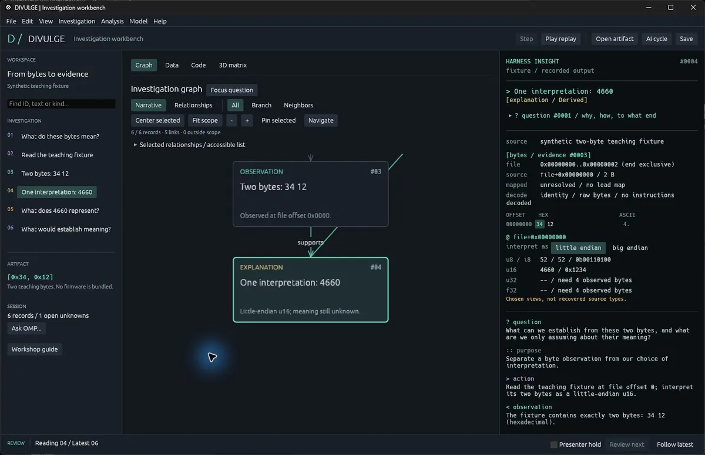
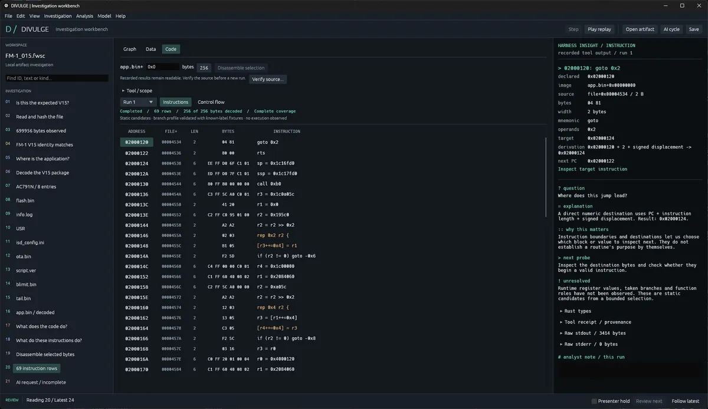
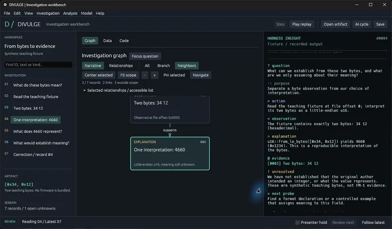

## What it is

DIVULGE is a native desktop application for investigating a binary with a model in the loop. The
window holds an investigation tree, an evidence graph, Data and Code views, and a terminal-style
Harness Insight panel; selecting a record shows its question, bytes, interpretation and remaining
uncertainty. It ships as an executable for Windows and Apple Silicon macOS, with a workshop and an
eighteen-page workbook beside it.

<figure>
  
  <figcaption>An actual Windows capture immediately after launching the app, with its built-in two-byte
  teaching example. The left tree and the centre graph select the same record; the right panel gives
  that record's question, bytes, interpretation and remaining uncertainty.</figcaption>
</figure>

The problem is speed: an investigation can produce faster than a person can read, so what a
model-assisted session leaves behind is a heap of output nobody can audit and a claim nobody can
trace back to a byte. DIVULGE keeps the human setting the objective and steering, the model doing
bounded probes, and every proposal citing the evidence it rests on.

## How it works

`src/` is layered so the domain does not depend on the UI. Coordinates are distinct types —
`FileOffset`, `PackageOffset`, `FlashOffset` and `MappedAddress`, declared in `src/domain.rs` and
`src/fwsc.rs` — so a file position cannot be passed where a mapped address belongs, and `RecordId`
stays stable across layout and replay. `src/coordinates.rs` binds a checked `ImageMap` to SHA-256
identities, so a span that crosses images or overflows is rejected before anything reads it.

`src/fwsc.rs` decodes the exact FM-1 V15 package: eight entries, header and directory CRCs, SFC/JLFS
application decoding and mappings back to original file offsets. `src/graph.rs` projects records into
the narrative and relationship layouts, `src/insight.rs` builds the panel text, and `src/history.rs`
keeps the ordered ledger that reopens a case without running anything.

<figure>
  
  <figcaption>Captured from the client after opening a saved V15 investigation offline. The inspector
  shows the two-byte static instruction at declared address <code>0x02000120</code> and the distinct source and
  image coordinates; the firmware file and any vendor executable are absent from the frame.</figcaption>
</figure>

Live work runs through three adapters, each a separate process bridge: `src/omp.rs` for a restricted
OMP SDK session, `src/rea.rs` for REA's byte-entropy operation, and `src/pi32.rs` for the vendor
disassembler. The OMP session exposes one read-only `read_evidence` tool with no filesystem access;
MCP, LSP, extensions, rules and skills are disabled, the active tool list is checked before any
generation, and Rust validates citations, integer offsets, alignment and bounds before a proposal is
recorded. Requests carry deadlines, output caps and a per-session request limit, and a bounded cycle
runs proposals sequentially within a budget with pause, resume and stop.

<figure>
  
  <figcaption>Explanation 4 of the seven-record synthetic replay: its question, action, evidence,
  limitation and next probe. A recorded fixture output, not a live model transcript.</figcaption>
</figure>

## Run it

The README asks for Rust 1.92 or newer, which is also the `rust-version` in `Cargo.toml`:

```sh
cargo run --locked
cargo run --locked -- --compact
cargo run --locked -- --large
cargo test --locked --all-targets
cargo run --locked -- --session investigation.divulge.json --artifact /path/to/FM-1_015.fwsc
```

Optional live features need their tools installed on the same computer: the OMP bridge needs Bun and
OMP SDK 18.14.2, REA evidence needs Node and the REA 6.8.0 package, and disassembly needs the vendor
pi32v2 tools plus Python inside WSL on Windows.

## Caveats

The release notes are specific. Windows is verified; Linux and macOS are unverified, and the macOS
package is locally signed but not notarized. Only the exact configured V15 identity is decoded — other
firmware versions are unsupported — and four raw package CRC differences remain unexplained rather
than being labelled corrupt. Live DeepSeek tests used synthetic teaching data only, so the OMP path's
behavior against a real case is not established, and static instruction explanations do not prove
runtime behavior or recovered function names.

Artifact reads are capped at 128 MiB and saved cases at 16 MiB, 4,096 events, 200 records and 1,000
edges. Saves use a new ledger envelope that older builds cannot read, and reopening a case runs no
tools or models until the source is verified again. Local cases retain byte previews, raw tool output
and machine paths, so sharing goes through the portable review export rather than the case file.
