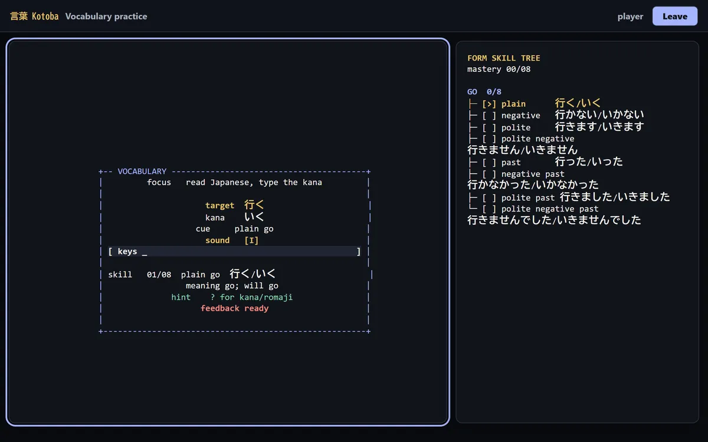

## What it is

Kotoba Line is a Japanese reading game reached over `ssh`. There is no shell or command runner: the server rejects any raw command and hands the session to a full-screen terminal app. The screen is a drill: a bordered VOCABULARY panel shows one target word in Japanese, its kana, a meaning cue, the keys typed so far, and a feedback line, while a side pane draws a form skill tree with a mastery count. The player types the reading, presses enter, and the next card appears.

<figure>
  
  <figcaption>The browser build in a 1280×800 window: the drill asking for the reading of 行く, with the skill tree beside it.</figcaption>
</figure>

The problem is the gap between reading Japanese documents and practicing them. A document is not naturally a drill, so the repository treats a text as a campaign: an importer turns a document into cards flagged for native review, cards without a curated reading are unplayable, and levels sit behind skill-tree requirements. Progress is an append-only event log replayed by a deterministic reducer, so learner state can be rebuilt from history rather than trusted from a save file.

## How it works

`cmd/kotoba-ssh/main.go` loads configuration from the environment, builds a server with `sshapp.NewServer`, and watches for an interrupt to shut down with a five-second timeout. `internal/sshapp/server.go` wraps `wish.NewServer` with a host key, a password callback, and `wishtea.Middleware`, which returns the Bubble Tea model per session; a session arriving with a command gets "Kotoba does not expose a shell or command runner." and nothing else. `internal/sshapp/config.go` defines the knobs and refuses a non-loopback bind while the shared development password is in use.

The loop lives in `internal/tui/app/model.go`: four modes (drill, boss, stations, transition) and a score table where a clean hit is 100 points, a hinted hit 40, a wrong key -5, and a cleared level 250. `internal/game/drill.go` draws enemies from a card deck, one every three ticks up to four at a time, and `internal/kana/keyboard.go` decides what counts as correct: the exact kana, the romaji hint, or keyboard syllables converted back to kana, so a player never fights a system input method.

State gets the most care. `internal/state/events.go` defines the event log; `reducer.go` replays events into a `Progress` value of per-card streaks, masteries, unlocked levels, and points, granting mastery once a streak crosses `MasteryCleanHitStreak`; `snapshot.go`, `sqlite.go`, and `postgres.go` persist it. `internal/skilltree/tree.go` turns cards and prerequisites into levels and requirement states, and `internal/boss/model.go` models bosses as HP phases over text chunks. Transitions are deterministic frame sequences from `internal/transition/scene.go`, seven scenes rendered by `internal/tui/transition/render.go` with pieces from `internal/tui/atoms`. `internal/sshapp/web.go` exposes the same model as HTML through login, `/play`, and `/api/key`.

## Run it

```sh
go run ./cmd/kotoba-ssh
ssh player@localhost -p 2222
```

Development defaults are user `player`, password `kotoba`, and `127.0.0.1:2222`; a non-loopback bind refuses that password until `KOTOBA_SSH_PASSWORD` is set. The browser variant runs the same model:

```sh
go run ./cmd/kotoba-web
```

It serves <http://127.0.0.1:8080/> with the same credentials. Go 1.26.1 is pinned in `go.mod` and in the `Dockerfile`'s `GO_VERSION` argument; dependencies include Wish 1.4.7, Bubble Tea 1.3.10, and pure-Go `modernc.org/sqlite` 1.53.0.

## Caveats

Content is one journal lesson and the preamble plus Article 1 of the Japanese Constitution, in the JSON fixtures under `content/`; the ten-ticket `ROADMAP.md` is still the plan of record, with Railway deployment, station MIDI hooks, and boss fights among its tickets. Station audio is empty by design: `assets/midi/README.md` reserves the directory, forbids copyrighted MIDI, and documents a silent visual pulse as fallback. The README's "Planned Stack" still lists Wish, Bubble Tea, and Railway as planned though the code depends on the first two, and it describes typing kana through a macOS input method while the input package takes plain keyboard syllables. A Railway deployment document and a login script pointing at a hosted URL exist, but nothing records a live deployment or its health, so no hosted service is claimed here. No learning-outcome measurements exist; the scoring constants are design choices.
