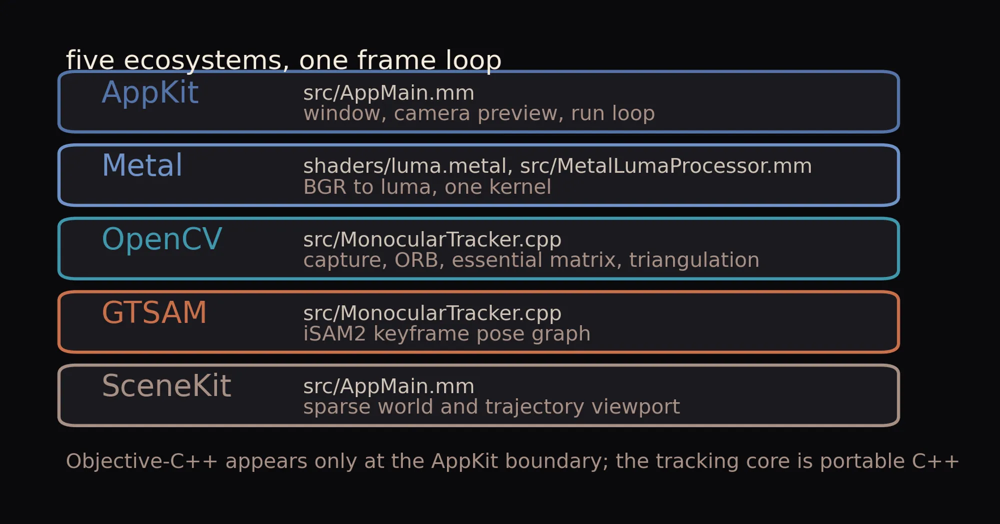

## What it is

A native macOS window, dark and card-based, that opens the built-in camera and shows four views of the same moment at once: the live feed with tracked feature points drawn over it, an interactive SceneKit viewport of the sparse coloured point cloud and the camera trajectory, a small top-down plot of that geometry, and a panel printing the current 4×4 world-to-camera matrix. A row of eight metric cards above the matrix reports the tracking state, the backend, and the counts — keypoints, matches, inliers, keyframes, cloud points, travel distance.

The problem it addresses is the seam between five ecosystems that each want to own the frame loop: AppKit for the window, Objective-C++ only at that boundary, C++ for the tracking, Metal for the per-pixel work, OpenCV for the geometry, and GTSAM for a pose graph that is updated rather than re-solved. It is a starter of about 1,800 lines across five files, and the README says as much: "a vSLAM starter, not a finished production SLAM system".

## How it works

`src/AppMain.mm` opens `cv::VideoCapture(0, cv::CAP_AVFOUNDATION)` at 1280×720 and 30 frames per second, starts a `NSTimer` at 1/30 s, and fans each result out to the image views, the SceneKit nodes and the labels. `MonocularTracker::process` in `src/MonocularTracker.cpp` is where the geometry happens.

Intrinsics are derived from the image size alone: focal length 0.9 × frame width, principal point at the centre. Luma conversion runs on the GPU through the `bgrToLuma` kernel in `shaders/luma.metal`, which CMake compiles with `xcrun metal` into `luma.metallib` beside the binary; `src/MetalLumaProcessor.mm` falls back to `cv::cvtColor` when no Metal device, library or `bgrToLuma` function is available, and the backend card reports which path actually ran. Contrast is equalised with CLAHE at clip 2.5.

<figure>
  
  <figcaption>The five ecosystems and the file that keeps each one in its lane, from the repository's own layout: <code>AppMain.mm</code> is the only Objective-C++, the Metal kernel is one function in <code>luma.metal</code>, OpenCV and GTSAM share <code>MonocularTracker.cpp</code>, and the viewport is SceneKit.</figcaption>
</figure>

<figure>
  
  <figcaption>One frame, from the camera to the reconstruction viewport, drawn from the functions in <code>src/MonocularTracker.cpp</code> and the <code>bgrToLuma</code> kernel in <code>shaders/luma.metal</code>. The Metal path owns only the greyscale conversion, with <code>EnhanceGrayFrame</code> as the CPU twin; every stage after it is C++ and OpenCV; and the pose graph is GTSAM's, updated once per accepted keyframe rather than re-solved from scratch.</figcaption>
</figure>

ORB features go through a Hamming brute-force matcher with a 0.75 ratio test, and the survivors are refined by pyramidal Lucas–Kanade optical flow with a forward-backward agreement check. A frame whose median motion is under 1.25 px holds the pose. Otherwise `findEssentialMat` (RANSAC, 0.999 confidence, a 0.55–1.35 px threshold that scales with motion) and `recoverPose` yield a relative motion, rejected when inliers drop below 24 or 45 percent, or when a 20-degree rotation appears with under 10 px of motion.

Translation magnitude is a heuristic rather than a measurement. `EstimateTranslationScale` multiplies normalised median pixel motion by the inlier ratio and clamps the result between 0.004 and 0.10.

Keyframes come from `ShouldCreateKeyframe`: at least 32 inliers, never fewer than five frames apart, forced at sixteen, otherwise promoted on a baseline past 0.18 or motion past 18 px. Each one adds a `gtsam::BetweenFactor<Pose3>` to an `ISAM2` graph keyed `x<i>`, with a prior on the first. `rebuildWorldGeometry` then re-anchors every triangulated point to its keyframe's optimised pose, so the cloud moves with the corrected trajectory. The caps are 24,000 anchored points, 18,000 transient, and 320 new per frame; the SceneKit world is rescaled to the cloud's bounding box, so the viewport shows shape rather than size.

## Run it

```bash
brew install opencv
./run.sh
```

`run.sh` configures CMake in Release, builds into `build/`, and runs `build/bin/macos-metal-vslam`. The build wants CMake 3.28 or newer, C++17, and Apple Silicon — `CMAKE_OSX_ARCHITECTURES` is forced to `arm64`. GTSAM is not installed by the script: it prepends `.deps/gtsam-install` to `CMAKE_PREFIX_PATH` when that directory exists, while `CMakeLists.txt` requires GTSAM through `find_package(GTSAM CONFIG REQUIRED)`. The first launch prompts for camera access.

## Caveats

The GitHub Actions workflow has failed on every push since the GTSAM commit. The workflow installs OpenCV and runs CMake, which requires a GTSAM config package no commit provides: four runs succeeded before that commit, four failed after.

Scale is arbitrary and camera intrinsics are approximated from image size, both admitted in the README. The pose graph holds camera poses only: landmarks are triangulated per keyframe pair outside the graph and re-anchored to the optimised poses afterwards, so the map is carried by the optimisation rather than corrected by it. Calibrated camera loading, multi-keyframe landmark management, local bundle adjustment, Metal acceleration for pyramids and descriptors, relocalisation and loop closure are all still roadmap items. There are no tests, and the counters are live readouts rather than a recorded run.
