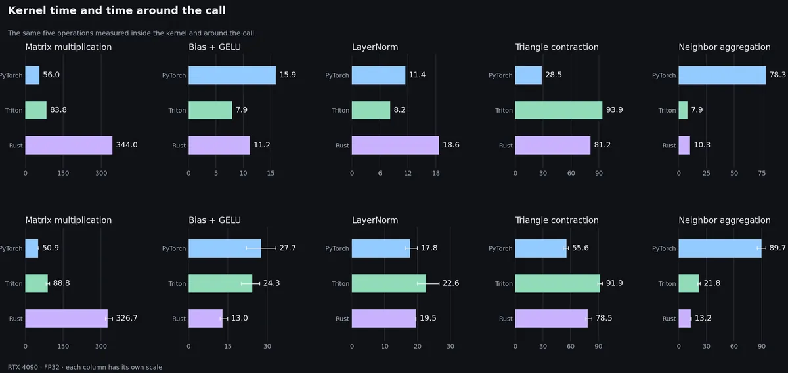
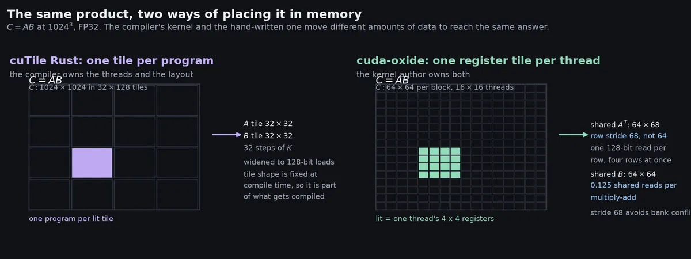
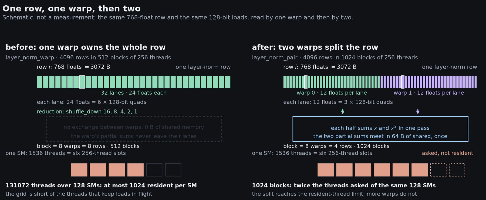
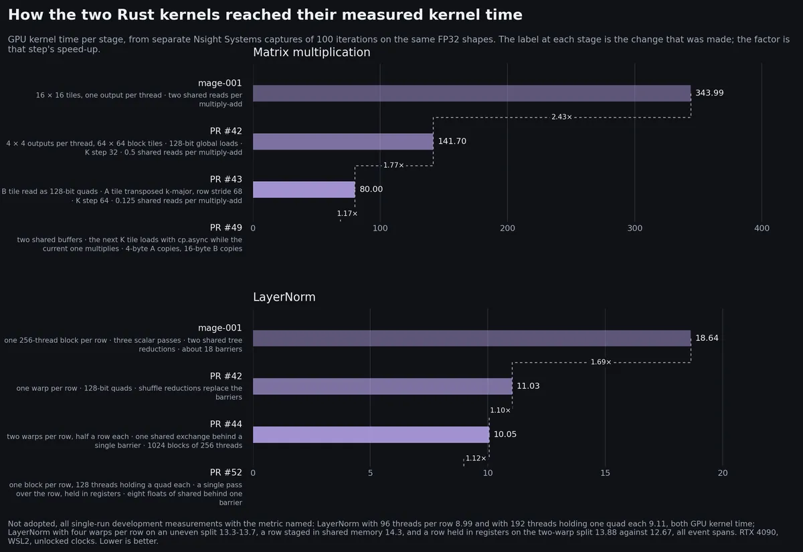

## What it is

Mage is a terminal GPU profiler with a Triton kernel library attached. The feature list is `add`,
`fma`, `relu`, `softmax` and `matmul`, each with an autograd wrapper; the profiler runs a Python
script or a native executable, intercepts every kernel launch, and prints a live table of kernel
name, duration, grid, block and thread count. `mage demo` checks the five operations against
PyTorch, `mage bench` times them, and `mage profile script.py` does the measuring.

<figure>
  
  <figcaption>Both views in one figure, from the first experiment. The top row is time inside the
  kernels; the bottom row is time around the call, and each column carries its own scale. Bias + GELU
  is where they disagree: Rust has the shorter span around the call, Triton the shorter
  kernel.</figcaption>
</figure>

The problem is that a rewrite can look like a win and be a loss: which implementation appears faster
depends on whether the clock starts inside the kernel or around the call. Mage makes that choice
visible at a human reading pace rather than inside a `.nsys-rep` file.

## How it works

`src/mage/cli.py` is one `argparse` tree with `demo`, `bench`, `profile`, `profile-exec` and
`stress` subcommands. Profiling dispatches to a backend under `src/mage/profiler/backends/`: the
default `triton_profiler.py` monkey-patches `triton.JITFunction.__call__`, wraps each launch in
`torch.cuda.Event` records, and emits a `KernelMetric` — a dataclass in
`src/mage/profiler/models.py` carrying duration, grid and block shape, registers, shared memory and,
where the capture supplies them, occupancy and cache hit rates. `aggregator.py` groups and
summarises those records, `tui.py` renders them into a Rich live panel, and `storage.py` writes
sessions and metrics into SQLite so `time_series` and `get_kernel_stats` can compare a kernel across
runs. `analysis.py` adds the roofline check: it reads the device's bandwidth and FLOPs, derives
the balance point in FLOPs/byte, and reports whether a kernel is memory-bound or compute-bound.

<figure>
  
  <figcaption>C = AB at 1024³ in FP32, drawn two ways. On the left the compiler chooses the threading
  and widens the loads; on the right the kernel author does. The transposed A with a row stride of 68
  exists so each thread's four rows are contiguous — one 128-bit read instead of four scattered
  32-bit ones.</figcaption>
</figure>

<figure>
  
  <figcaption>A schematic, in the figure's own words, not a measurement: the same 768-float row and the same 128-bit loads, read by one warp and then by two. <code>layer_norm_warp</code> puts 4096 rows in 512 blocks of 256 threads; <code>layer_norm_pair</code> puts the same rows in 1024 blocks. It is the change the kernel progression measured at 1.37× for LayerNorm at 4096×4096, drawn before it was timed.</figcaption>
</figure>

The kernels themselves are `@triton.jit` functions in `src/mage/kernels.py` and the operation
modules beside it (`matmul.py`, `normalization.py`, `attention.py`, `rope.py`, `fused_mlp.py`).
`examples/oxide/` is the separate Rust track: the same five operations built with pinned cuda-oxide
tooling, so `mage profile-exec` measures a native binary through the same display and SQLite
history.

<figure>
  
  <figcaption>GPU kernel time at each stage of the rewrite, from separate Nsight Systems captures of
  100 iterations on the same FP32 shapes. Each stage is labelled with the change that produced it,
  including the attempts measured and not adopted.</figcaption>
</figure>

## Run it

The reproduction guide pins PyTorch 2.9.1 with its `cu128` wheel and Triton 3.5.1. The `mage` name on
PyPI belongs to an unrelated project, so the README installs from source:

```bash
uv tool install git+https://github.com/superposition/mage
uv add --dev git+https://github.com/superposition/mage

git clone https://github.com/superposition/mage.git
cd mage
uv venv && uv pip install -e . pytest
```

```bash
mage demo
mage bench matmul
mage profile script.py --backend triton
mage profile script.py --backend nsys --analyze
mage profile script.py --columns kernel,duration,grid
```

The Rust examples need more: CUDA Toolkit 13 or newer, driver R580 or newer and Clang 21, which
`scripts/bootstrap-oxide.sh` installs, plus the pinned `nightly-2026-08-28` toolchain that
`docs/guide.md` adds.

## Caveats

The measurements are five fixed FP32 shapes on one WSL2 workstation with an RTX 4090, unlocked clocks
and no exclusive-use guarantee. `docs/experiments/mage-003.md` records that Nsight Compute counters
are unavailable on that host, so occupancy, cache-hit rates and memory throughput are not measured
there; the captures run on NVIDIA's CUDA-timestamp fallback, which the docs call less precise. The
README says the comparisons include regressions and are not a general ranking of Python, Triton or
Rust.

The autograd wrappers cover Mage's own operators only; the README says the Rust and Triton research
examples are forward-only. Nsight Compute needs counter access, which `docs/profiling.md` describes as
a host permission setting rather than something installing a driver in WSL fixes. The Rust track pins
cuda-oxide to one revision, its own Rust nightly, and CUDA 13 or newer, so any newer combination is
untested.
