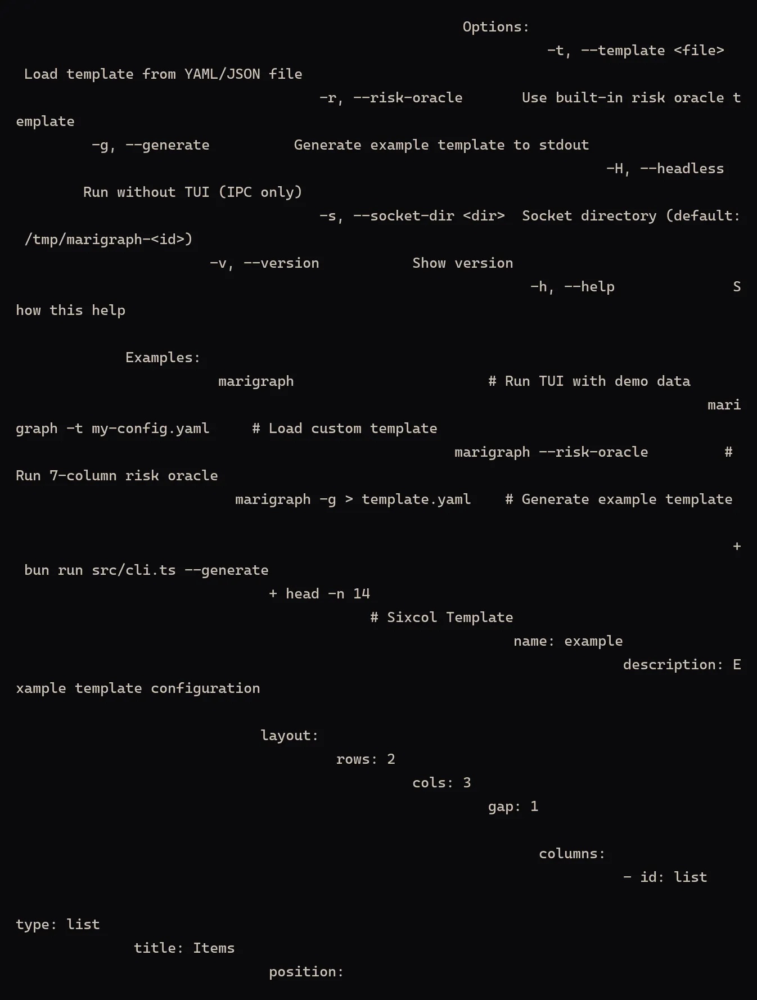

## What it is

A Bun and Ink terminal application that renders an options volatility surface as a rotating, shaded object of block characters, surrounded by the numbers it implies. `src/tui/index.tsx` draws the columns and `src/cli.ts` is the entry point; underneath sit a 3-D projector, a character rasterizer, streaming statistics, an SVI fit, an arbitrage checker, and Solidity contracts.

<figure>
  
  <figcaption>The seven-column risk oracle on its demo surface data, paused at the block the fork config pins — 20,450,000, 5 August 2024 — with the day labelled <em>Yen Carry Trade Unwinding</em> and ETH at $2054. The middle band is the surface itself, drawn as block characters by <code>src/render/rasterize.ts</code> and rotated by a hand-rolled camera; the row beneath it is the oracle's own reading, RV 222.6% against IV 98.7%, a variance risk premium of −124.0% and 4% risk. The five panels are separate worker processes rendering into their own columns.</figcaption>
</figure>

The thing drawn is implied volatility across strike and time to expiry. It is a surface, and the information is in its shape: the skew of a smile, whether variance rises with expiry, where a butterfly spread turns negative. As a grid of numbers it is unreadable, and plotted it wants a graphics stack a terminal lacks. Marigraph projects it to two dimensions, rasterizes the projection into characters, and sets the diagnostics that fall out of the shape beside it.

<figure>
  
  <figcaption>The CLI's two doors: <code>--help</code> lists the template, risk-oracle, headless and socket options, and <code>--generate</code> prints the layout contract a column configuration has to satisfy — rows, cols, gap, then one entry per column with its id, type, title and position.</figcaption>
</figure>


## How it works

`createProjection` in `src/render/project.ts` is a hand-rolled camera: azimuth 45°, elevation 30°, zoom 32, and an `aspectRatio` defaulting to 0.5 because a terminal cell is about twice as tall as wide. Every 3-D point comes back with a depth that draw order and shading use.

`src/render/rasterize.ts` turns that into text. `createBuffer` allocates three `width`×`height` grids — characters, colours, and depths initialised to `-Infinity` — and `setChar` keeps whichever sample is closest, so later geometry never paints over nearer geometry. `drawLine` is Bresenham, but a segment drawn in `─` re-picks its glyph from `│`, `╱` or `╲` by angle, so a wireframe reads correctly at any rotation. Surface cells go through `getLitChar`, which mixes normalised height with a lighting term into the ramp `· ∙ : ░ ▒ ▓ █ ▀`, and `getLitColor`, which does the same into an ANSI colour that `bufferToAnsi` emits.

The finance side is separate modules. `src/surface/svi.ts` implements Gatheral's raw SVI parameterisation — total variance `w(k) = a + b(ρ(k − m) + √((k − m)² + σ²))` — defaulting to a typical equity smile with `ρ` at −0.4. `src/surface/arbitrage.ts` checks the conditions a usable surface must satisfy: total variance must not fall as expiry lengthens, and butterfly spreads must not go negative. Violations come back typed `calendar`, `butterfly` or `vertical`, each with a severity. `src/stats/welford.ts` keeps mean, variance, skewness and kurtosis in one pass, updating `m4` before `m3` before `m2` because each depends on the ones below.

`Sixcol.start()` in `src/main.ts` spawns a worker per column with `Bun.spawn()`, and each worker renders its own widget and talks to the parent over stdin and stdout in binary frames: an 8-byte header of `length: u32`, `type: u8`, `flags: u8`, `seq: u16`. Columns are wired to each other in YAML, and a socket per column exposes the same traffic as JSON-RPC.

## Run it

From `package.json` and the README:

```bash
bun install
bun run dev          # TUI with demo data, hot reload
bun run start        # TUI
bun run cli --help   # CLI options
bun test
bun run typecheck    # tsc --noEmit
```

The runtime is Bun, pinned by `bun.lock` with `@types/bun` at `latest` and TypeScript `^5` as a peer; the UI is `ink` 6.5.1 on `react` 19.2.1, with `viem` for chain reads and `yaml` for templates. The contracts compile under Hardhat 3.0.17 with Solidity pinned to `0.8.26`, optimizer on at 200 runs with `viaIR`.

## Caveats

The surface on screen is synthesised. `createMockSnapshot` in `src/chain/volatility.ts` builds it from a seeded linear-congruential generator, a base price of 2500 with a sine term and an event shock, liquidity chosen by event severity; its own comment says production would fetch from the chain. A Uniswap v4 reading path exists in `src/chain/`, unused by the TUI.

The multi-process plumbing is unfinished: `src/column/worker.ts` stores an incoming `SET_DATA` payload and carries a `TODO: trigger re-render`, so the message lands and the widget does not redraw. The socket directory is `/tmp/sixcol-<timestamp>` in `src/main.ts`, while `src/cli.ts` and `CLAUDE.md` describe it as `/tmp/marigraph-<id>`.

The on-chain half is unproven. `contracts/` holds `VolatilityOracle.sol`, `VolatilityMath.sol`, two keepers and a Uniswap v4 hook, and `hardhat.config.ts` points its tests at `./test`, a directory the repository does not contain. The five test files cover the frame codec, the renderer, the statistics, the main process and the external bridge; nothing tests SVI or the arbitrage checks. Running `bun test` on Windows gives 120 passing, 5 failing — four `Sixcol main process` cases time out after five seconds spawning column workers, and the external-program bridge test fails. That is one machine, not a claim about others.
