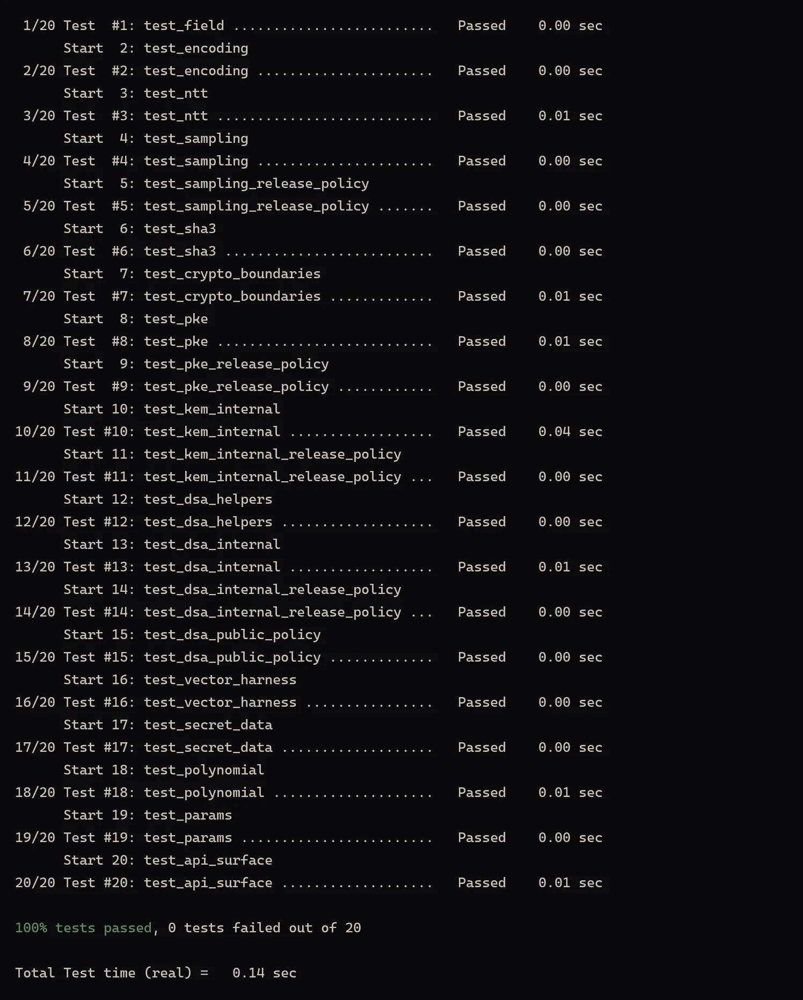
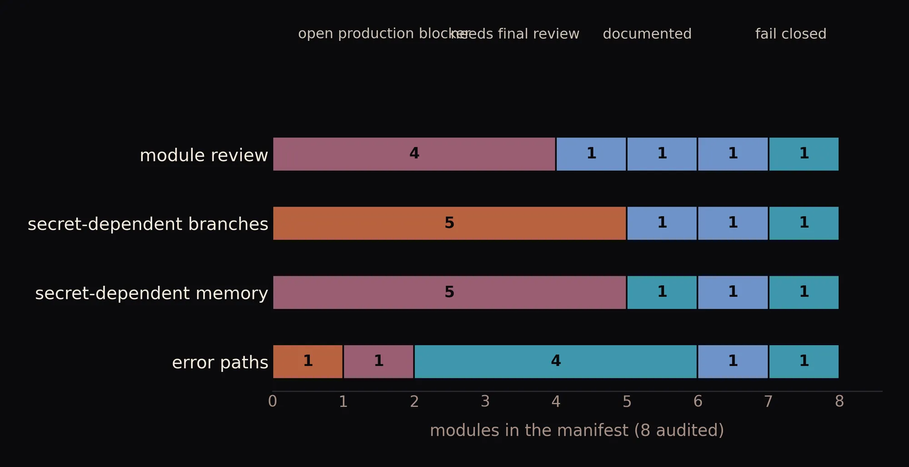

## What it is

A header-only C++20 library of sixteen headers under `cpp/include/pqcore/`, beside a Rust crate, a directory of derivation notes, shared JSON fixtures, and a vendored set of NIST test vectors. There is no compiled library and almost nothing to call: the C++ side is a CMake `INTERFACE` target, and the two functions a reader reaches for first — `ml_kem_keygen` and `ml_dsa_sign` — check what they can and then throw.

The subject is post-quantum cryptography: ML-KEM (formerly CRYSTALS-Kyber, FIPS 203) for key encapsulation and ML-DSA (formerly CRYSTALS-Dilithium, FIPS 204) for signatures. The repository's problem is narrower than "implement them". It is that a compiling cryptography API is actively misleading — it looks finished while the mathematical object underneath may be misunderstood. So each piece is derived from the standard first, with its invariants stated in prose and pinned by a fixture and a test, before anything becomes public. `docs/derivation-first-development.md` writes the loop out as eight steps, and each derivation module in `docs/` is one pass through it.

## How it works

The arithmetic lives in `cpp/include/pqcore/field.hpp` as a single class template, `ModQ<Q>`, with `constexpr` addition, subtraction, multiplication, a `value()` in `[0, Q)` and a `centered()` that maps to `(-Q/2, Q/2]`. Two aliases instantiate it: `MlKemField` is `ModQ<3329>` and `MlDsaField` is `ModQ<8380417>`. Above that, `params.hpp` returns per-parameter-set metadata from a `constexpr` switch — ML-KEM-512 arrives as a struct with `k = 2`, `eta1 = 3`, `du = 10`, `dv = 4`, an 800-byte public key and a 768-byte ciphertext — so key and ciphertext sizes come from the standard, not a call-site literal.

The number-theoretic transform in `ntt.hpp` is derived instead of tabled: `kMlKemNttRoot` is 17, `bit_reverse_7` reverses seven-bit indices, and `ml_kem_ntt_zeta`/`ml_kem_ntt_gamma` raise the root to bit-reversed powers for the twiddle factors, which the tests check against a schoolbook multiplication used as an oracle. `sha3.hpp` carries its own Keccak-f[1600] with the 24 round constants and rotation offsets inline, and the ML-KEM `H`/`G`/`J`/PRF/XOF wrappers and ML-DSA hash boundaries sit on top of it. `fixtures/` holds the shared expected values — parameter tables, polynomial products, NTT round trips, encoding examples, sampling bounds — that both languages answer to.

The public boundary is `kem.hpp` and `dsa.hpp`, and it fails closed. Each entry point validates the arguments it can see (`public key has the wrong length`, `context is longer than 255 bytes`) and then throws `NotImplemented` naming the gate that has not passed. The real algorithms are internal: `pke.hpp` is an ML-KEM-512 test-hook encryption layer, `kem_internal.hpp` runs encapsulation and decapsulation with implicit rejection, and `dsa_internal.hpp` is a signing-flow harness. Secret material is typed as `pqcore::SecretBytesView`, a redacting wrapper whose `operator<<` prints nothing useful.

## Run it

The README's test commands, which `make test` chains together:

```bash
cmake -S cpp -B build/cpp -DPQCORE_BUILD_TESTS=ON
cmake --build build/cpp
ctest --test-dir build/cpp --output-on-failure
cargo test --manifest-path rust/pqcore/Cargo.toml
cargo run --manifest-path rust/pqcore/Cargo.toml --bin rust-vector-runner -- --manifest test-vectors/manifest.json
bash scripts/check-docs-glossary.sh
python3 scripts/check-vector-manifest.py --self-test --require-official
python3 scripts/check-side-channel-manifest.py --self-test
bash scripts/check-rust-crate-gate.sh

<figure>
  
  <figcaption>The C++ suite, run the way the README's command list says: configure with <code>-DPQCORE_BUILD_TESTS=ON</code>, build, then <code>ctest</code>. Twenty tests, all passing, 0.11 s of test time. The names are the derivation gates the rest of the repository is arranged around — <code>test_kem_internal</code>, <code>test_dsa_public_policy</code>, <code>test_vector_harness</code>, <code>test_secret_data</code>.</figcaption>
</figure>

```

The toolchain is pinned by declaration: CMake 3.20 or newer and `cxx_std_20` for the C++ side, Rust edition 2021 with `serde` and `serde_json` 1.0 for the crate, plus a `python3` and a `bash` for the manifest checks. CTest registers twenty test executables, including release-policy tests that assert the deterministic sampling hooks stay unreachable without `PQCORE_ENABLE_TEST_SAMPLING`.

## Caveats

Nothing here is production cryptography, and the repository says so repeatedly. `ml_kem_encapsulate` throws; there is no shared secret to be had from the public API. `docs/production-readiness.md` lists six gates and none is met: no official FIPS 203 or 204 vector pass, no constant-time review, no RNG policy review, no fuzzing in CI, no external review, no versioned release.

The vector story is deliberately unflattering. The ACVP prompt and expected-result files are vendored and hash-checked, but the Rust runner can only report them as pending — `docs/vector-ingestion.md` records the actual output of a real run, `summary passed=0 pending=859 skipped=0 failed=0`, and a unit test in `rust/pqcore/src/vector_runner.rs` pins that 859. A missing vector set is never silently treated as a pass.

`audits/side-channel/manifest.json` sets `gate_status` to `incomplete-production-blocker` with `production_status: false`, and names the reasons across eight modules: value-dependent normalization branches in the field arithmetic, rejection loops in the samplers that branch on secret candidates, and unreviewed optimized compiler output. There are no benchmarks and no performance claim, and no cross-implementation differential result: the Rust crate exposes no public algorithm, so the C++/Rust comparison the derivation loop calls for cannot run.

<figure>
  
  <figcaption>The side-channel manifest, counted: eight modules, and for each of its four review dimensions how the entries are marked. Five modules carry an <code>open-production-blocker</code> secret-dependent branch, and five need a final review of secret-dependent memory access. That is what <code>gate_status: incomplete-production-blocker</code> looks like when you count it rather than read it.</figcaption>
</figure>

