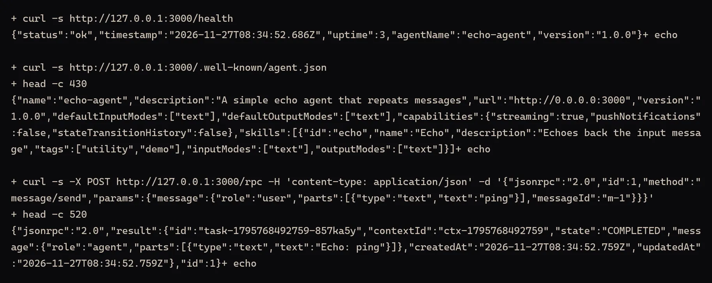
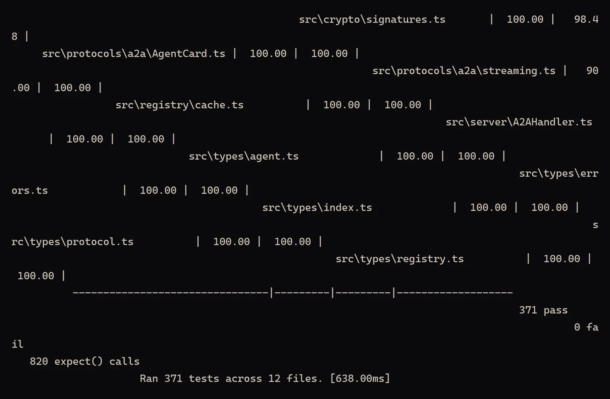

## What it is

A TypeScript SDK that runs on Bun, holding an A2A agent server and client, a client for the NANDA agent registry with a SQLite-backed cache and multi-registry resolution, DID-based identity with AgentFacts metadata, an NLWeb client, a partly built MCP bridge, and a CLI with five commands. `docs/wiki/` carries the manual, `examples/` four runnable programs, and `tests/` twenty-three test files. Around 4,500 lines of TypeScript live in `src/`.

The same tree also carries hardware: an ESP32 firmware directory for an M5StickC badge agent, a Dockerfile and compose file for running an agent on a Jetson, and an adapter under `src/adapters/jetson-ugv` for a tracked ground vehicle. The problem the SDK addresses is the one an agent has before it can talk to anything: a card describing its skills, an endpoint that speaks A2A JSON-RPC, a handle in a registry, and an identity other agents can check. It does that with no third-party runtime dependencies, on Bun's built-ins alone.

## How it works

`src/server/AgentServer.ts` wraps `Bun.serve` with a fixed set of routes: `GET /.well-known/agent.json` returns the agent card, `/health`, `/healthz` and `/readyz` return health responses, `POST /rpc` dispatches JSON-RPC and switches to server-sent events when the request's `Accept` header asks for `text/event-stream`, and `POST /rpc/stream` always streams. CORS headers go on every response. Handlers are registered by JSON-RPC method name through `on`, and `onMessage` binds the `message/send` method to a callback that can create tasks and update their state.

<figure>
  
  <figcaption>The example server, three requests: <code>/health</code> reports the echo agent, <code>/.well-known/agent.json</code> returns the card with its single skill, and a <code>message/send</code> JSON-RPC post comes back as a task in state <code>COMPLETED</code> carrying <code>Echo: ping</code>. That round trip is the claim the README makes, run against the tree as committed.</figcaption>
</figure>

`src/server/A2AHandler.ts` is the dispatcher behind those routes: a map from method name to handler, an in-memory task store, and three built-in methods — `tasks/get`, `tasks/list` and `tasks/cancel` — that operate on it.

`src/registry/IndexClient.ts` talks to `https://api.projectnanda.org/v1` by default: `POST /agents` to register, `GET /agents/:handle` to resolve (a 404 becomes `null`), and a query-string search. `src/registry/cache.ts` wraps `bun:sqlite` with a TTL, five minutes unless configured. `src/registry/QuiltResolver.ts` resolves one handle across several registries in parallel and merges the agent card, the AgentFacts document and the endpoint list into one record.

Identity is `did:key`: `src/crypto/keys.ts` base58-encodes a 32-byte public key behind the Ed25519 multicodec prefix `0xed01`, and `src/agent/Identity.ts` attaches that DID to a core identity record. `src/agent/AgentFacts.ts` validates the AgentFacts document, requiring a core identity and a baseline model.

## Run it

```bash
bun install
bun test tests/unit
```

That is 371 tests across 12 files, passing in under two seconds; `bun test tests/integration` adds 209 across 11 files against mocked registries. To serve the example agent:

```bash
PORT=3111 bun run examples/basic-server.ts
curl http://127.0.0.1:3111/.well-known/agent.json
```

The card comes back with the echo skill, and a `message/send` JSON-RPC post to `/rpc` returns a task in state `COMPLETED`. The example listens on port 3000 unless `PORT` says otherwise.

<figure>
  
  <figcaption>The unit suite as the README's second command runs it: 371 tests across 12 files, 0 failures, 820 assertions, 638 ms. The coverage rows above the summary are Bun's own, printed per file; the integration suite, which the page counts separately, is a different command.</figcaption>
</figure>

## Caveats

The package root exports types and constants only. `src/index.ts` re-exports `./types` plus `VERSION`, `DEFAULT_REGISTRY_URL`, `DEFAULT_TIMEOUT` and `DEFAULT_CACHE_TTL`, while the client, server, protocol and registry exports are still commented out under a "subsequent phases" note — so the README's `import { AgentServer } from 'nanda-ts'` does not resolve today, and the example imports `../src/server/AgentServer` directly. The `exports` map does publish `nanda-ts/server` and the other subpaths.

Cryptography is a placeholder and says so in its own comments: `generateKeyPair` fills both the private and public key with random bytes instead of deriving one from the other, and `sign` returns `SHA-256(privateKey || data)` rather than an Ed25519 signature, with `@noble/ed25519` named as the eventual dependency. A DID minted here would not verify against a real `did:key` resolver.

The MCP half is a stub. `MCPBridge` throws "MCP client connection not yet implemented", "MCP tool calls not yet implemented" and "MCP message send not yet implemented", and both transports in `src/protocols/mcp/transport.ts` throw as well. Of the 21 open issues, the five highest-numbered are all MCP work: two stdio transports, an SSE transport, an MCP client, and an agent wrapper that bridges A2A.

Two smaller oddities are worth knowing before cloning: 1,029 files under `firmware/m5stick-nanda/.pio/build` are committed, out of 1,134 tracked files in total, and GitHub labels the repository C rather than TypeScript because the firmware tree is the bulk of it. The test suite is green, but the registry and MCP paths are proven against mocks — there is no CI configuration in the repository at all.
