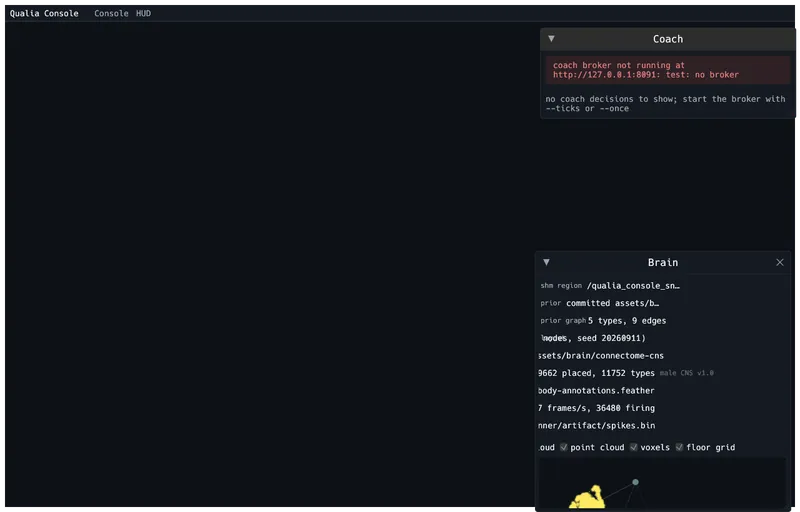
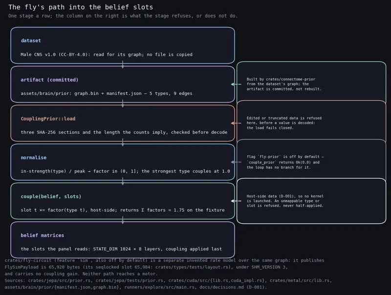
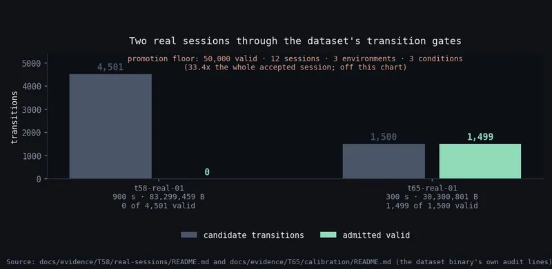
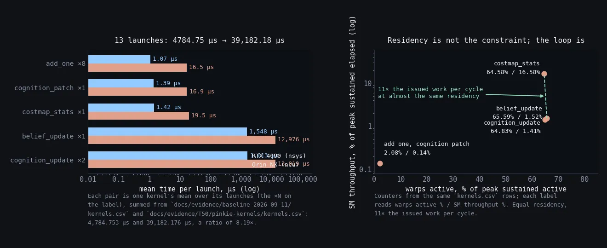

## What it is

Qualia is a Rust workspace of 20 crates and 32 runner binaries for embodied agents: a typed
shared-memory arena every process maps, crash-safe evidence logs, SQLite session storage, a JEPA model
runtime, and the CUDA and Metal backends the kernels run on. It builds on Windows, macOS and Linux;
kernels develop on an RTX 4090 and deploy to a Jetson Orin Nano with 8 GB of VRAM.

<figure>
  
  <figcaption>The console's Brain panel with a real runner stream loaded. The cloud is the released
  male-CNS connectome placed in 3D; the lit points are the tick's firing set. It drew 9,976 of
  139,662 placed points and 3,728 of that tick's 36,480 firing nodes — cloud decimated, firing
  strided — and reports both.</figcaption>
</figure>

An agent loop that learns has three failure modes ordinary code does not: state every process must
see and none may own, evidence that must survive a crash mid-write, and a rule for when a newly
trained model may replace the running one. A database, a log file and a human usually answer those;
Qualia makes each a typed component with its own gate.

## How it works

`crates/shm` is the arena. One process, `qualia-init`, creates a region of fixed size; every other
runner attaches by name and shares the mapped bytes. The layout is ABI: the `ShmHeader` at offset
zero, per-layer `LayerSlot`s, the `LedgerEntry` ring, then the world, thought, lore, sensor and JEPA
regions. Nothing in the crate owns state — the bytes are the state, and `qualia-types` declares the
atomics and seqlocks guarding it. `crates/mcap-log` writes MCAP segments so a partial write
quarantines instead of vanishing, and `crates/session-store` keeps sessions, epochs and missions in
SQLite.

The gates live on the model side. `crates/jepa-model` trains a world model: `train_batch` in
`crates/jepa-model/src/train.rs` encodes an observation, predicts the future latent from the applied
action, and takes one optimizer step. `crates/jepa-registry` is the only component allowed to approve
a checkpoint. It re-reads the manifest, the safetensors weights, the training report and the dataset
manifest, re-derives their digests, and refuses anything that does not reproduce from that evidence.
Activation is a three-step journal — a `prepared` row, an atomically renamed pointer file, an `active`
row — with `reconcile` repairing a crash between the last two.

<figure>
  
  <figcaption>How the connectome artifact reaches the belief slots. The coupling is host-side
  arithmetic with no kernel, the <code>fly-prior</code> flag is off by default, and an unmappable mapping is
  refused rather than approximated.</figcaption>
</figure>

<figure>
  
  <figcaption>Two real recordings through the dataset's transition gates. The first produced 4,501
  candidates and none valid — all rejected at <code>calibration_missing</code>, because no runner wrote a
  <code>calibration_id</code>. The second, with that fixed, kept 1,499 of 1,500. The promotion floor sits 33.4×
  above it.</figcaption>
</figure>

`crates/gates` is the repository checking itself: `qualia-gates figures` verifies each figure
directory has its generator, palette and size budget, and `qualia-gates journal` refuses a relative
figure URL.

## Run it

Two long builds have Makefile targets; one fatbin carries both the 4090 and the Orin Nano:

<figure>
  
  <figcaption>Thirteen launches on the 8 GB Orin Nano, from <code>docs/figures/the-4090-and-the-nano/</code>: 4,784.75 µs of sustained kernel time against 39,182.18 µs elapsed from first issue to last completion. The figure's own headline is the reading — residency is not the constraint, the loop is — and the per-launch times run from 1.07 µs for <code>add_one</code> to 16.9 µs for <code>cognition_patch</code>.</figcaption>
</figure>

```bash
make agent
make cuda-fatbin          # CUDAARCHS='87-real;89-real' by default
make run-agent
make test-agent
```

The stack's manual end-to-end run is the 4090 runbook:

```bash
cargo build --release -j 2
qualia run --manifest config/stack-manifest.zero-motion.json
powershell -NoProfile -ExecutionPolicy Bypass -File scripts/mission-4090.ps1 -MissionId explore-frontier-1
```

## Caveats

The learning loop is the point of the project and the part that is not closed. No checkpoint has been
promoted, so nothing trained is in the loop. The promotion floor is a corpus requirement, not a code
one: 50,000 valid transitions across 12 sessions, 3 environments and 3 conditions, against 1,499
transitions in one session in one place.

The connectome controller works and does not learn. It is a sparse leaky integrate-and-fire network
with membrane potential and a refractory counter, no plasticity and no neuromodulation, and its
left/right/hold commands went to a trace CSV rather than a wheel, because the motor port belongs to
another process by design. The encoder and read-out are chosen constants, not a fit. The two board
runs also disagree on their command split, which the docs report as a fact about the runs, not a
result.

The repository's own style checklist requires every journal entry to close with a "What this does
not establish" section, and several hardware paths — the live socket to the board, the lidar and
drive success paths, the console's renderer on the robot — are recorded there as unexercised.
