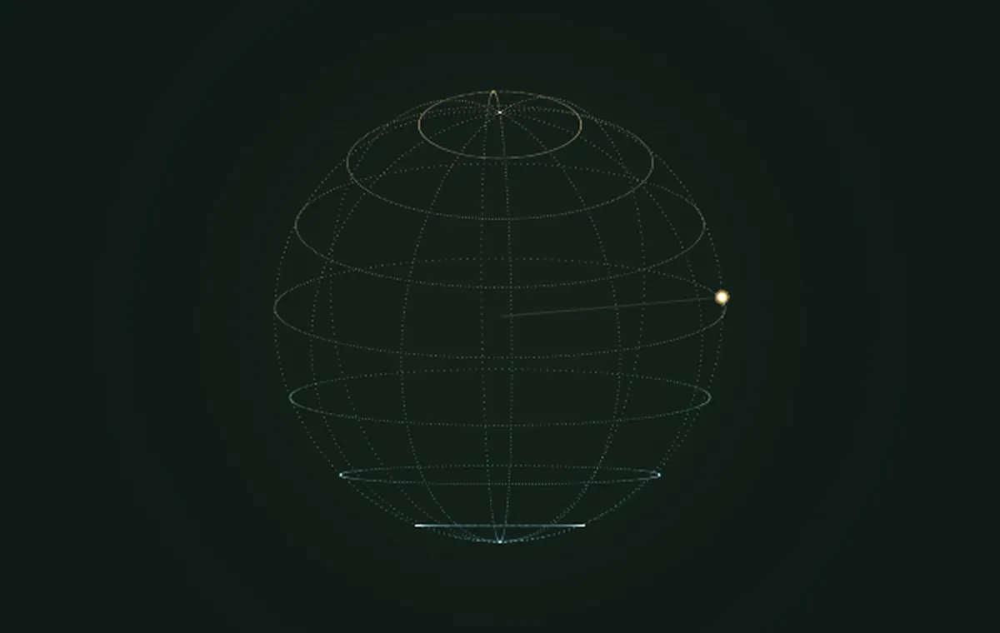
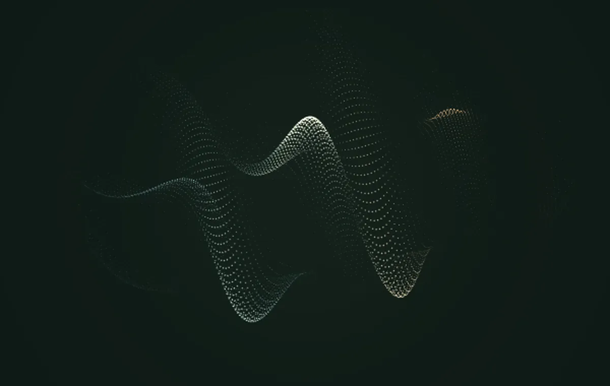

## What it is

The page opens on a gallery of eight cards, and clicking one loads that model into the viewport below. Each card is one quantum model — wave interference, complex amplitude, a pure qubit, pure and mixed states, equal-probability sections, measurement, Clifford gates, Pauli operators. From there the reader has two sliders, a basis select and four preparation buttons: balance sets the chance of one in a Z measurement, phase sets the angle between the two amplitudes, the buttons prepare zero, one, plus or minus, and the select switches the basis between X, Y and Z. Move either slider and the picture changes with it.

<figure>
  
  <figcaption>The pure-qubit model: the Bloch sphere, its three axes, and a copper line pointing to the prepared state. The still is one of the eight committed preview renders in <code>public/gallery/</code>.</figcaption>
</figure>

Most introductions to superposition start with a vector and a probability rule, and ask the reader to take both on trust. Each of these models shows the vector instead, draws it large, and states in the text beneath the canvas what the picture does not mean — that the field is not a particle density, that the sphere is not a particle moving through space, that a batch of measurements samples fresh copies.

## How it works

The physics is one small module. `src/quantum.js` is 63 lines and holds every equation the site uses: `blochVector` maps a balance and a phase to the three components of a pure state, `dephasedVector` scales the two transverse components by a coherence factor, `purity` returns half of one plus the squared length of the vector, `sectionRadius` gives the radius of the equal-population disk, `collapse` returns a fresh preparation for each measurement basis, and `waveAt` evaluates two plane-wave modes under a shared Gaussian envelope. Everything on screen is drawn from those return values.

Drawing is WebGPU through the `vgpu` library. `src/pipeline.js` builds one scene out of three passes — a background effect, a single instanced draw of 32,768 points with additive blending, and a fullscreen phase shader — and picks between them by model number. The shaders are string constants in `src/shaders.js`. `src/catalog.js` holds the eight entries as data: id, title, group, an equation line, and paragraphs for coordinates, boundary and encoding, which the page renders as the explanation beside the canvas.

Quantum logic is modelled exactly rather than numerically. `src/clifford.js` stores each gate as a signed permutation of the Pauli axes — Hadamard is `[3, -2, 1]` — and `transformVector` applies them to the Bloch vector, so a sequence never accumulates rotation error. The 24 proper orientations are generated from Hadamard and phase, with overall phase ignored.

`src/renderer.js` projects sphere points to screen coordinates, which is also how the accessible DOM labels are placed at the poles, and it owns the fallback Canvas path and the gallery previews. Those eight previews share one WebGPU device and stop rendering when they scroll out of view.

<figure>
  
  <figcaption>Wave interference: 32,768 field samples drawn as instanced points, with height reading as real amplitude and brightness as intensity. Animation moves the common phase without changing the intensity pattern.</figcaption>
</figure>

## Run it

Node.js 22.12 or later. The dependencies include `vgpu` 0.4.0 and Vite 7.3.6.

```sh
npm ci
npm run dev
npm test
npm run build
npm run test:gpu
```

`npm test` runs the physics and Clifford suites plus a DOM integration check over all eight models, sequence history, undo and measurement. `npm run test:gpu` is the optional one: it needs a native WebGPU adapter, which `npx vgpu doctor` will tell you about, and it renders every model and parameter variant, checks that the controls change pixels, and compares the phase shader against the CPU equations. `npm run gallery:render` regenerates the eight committed previews.

## Caveats

The field is illustrative by construction. The repository says the wave view combines two plane waves in arbitrary units, is not normalized as a probability density, and is not a Schrödinger solver; its points sample a field rather than representing particles. Entanglement, energy relaxation and physical gate dynamics are outside every model, and clipping the Bloch ball for the equal-probability section is described as a geometric operation, not a quantum one.

Measurement randomness is not quantum. `measure` accepts a random source and defaults to `Math.random`; the page itself passes `crypto.getRandomValues` from `src/main.js`, so the illusion is at least a cryptographic one.

The visual claims are conditional. The GPU check requires a native adapter, so CI runs the physics, interaction and production-build checks without one, and the committed PNGs are 600×380 renders from whichever machine produced them. This is a teaching instrument: the models are correct as models, and none is a simulation of hardware.
