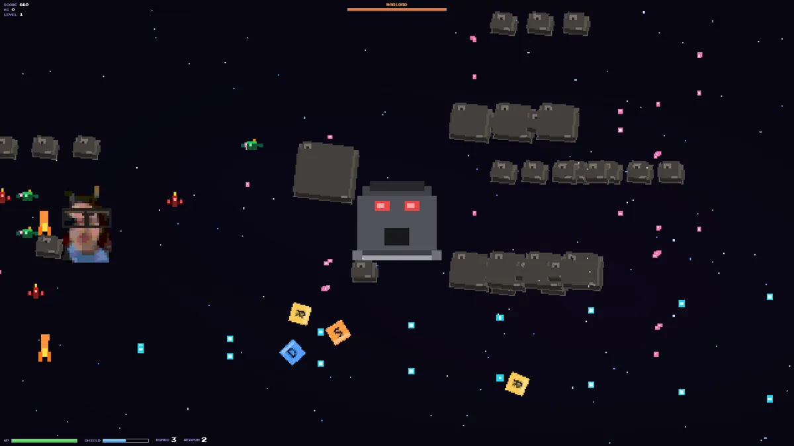
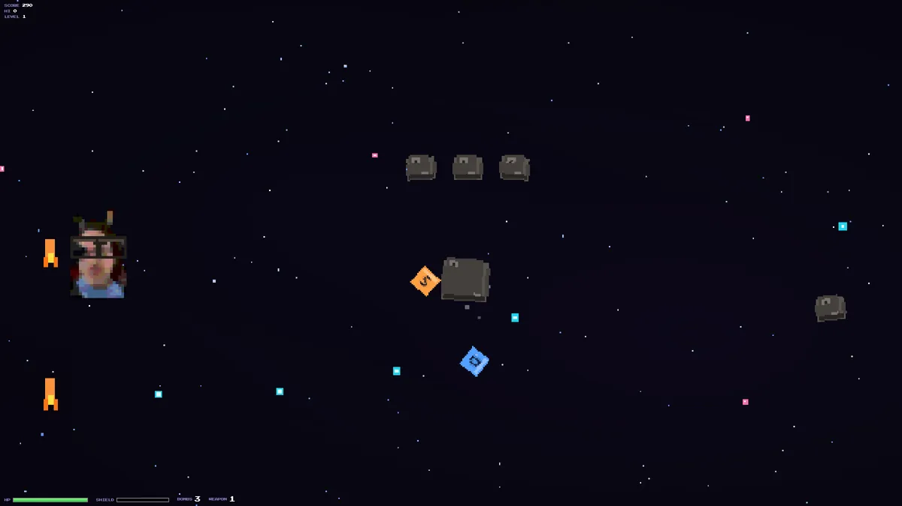

## What it is

A browser game with no build step. `index.html` holds the markup, the CSS and an import map; six ES modules in `js/` hold the game, and three.js revision 185 is vendored under `js/vendor/three/` so nothing is fetched from a CDN. It renders into a fixed 640×360 buffer that CSS scales to the window with `image-rendering: pixelated`, and it requires WebGPU, with no WebGL path.

<figure>
  
  <figcaption>WARLORD, the first of the five bosses, at full health (900) in THE DATA RING. The
  score reads 660 and the weapon has been upgraded to 2. The HUD is DOM sitting over the canvas;
  everything else on screen is drawn by the renderer into the 640×360 buffer.</figcaption>
</figure>

The problem is a rendering budget with no slack. A bullet hell puts hundreds of moving sprites on screen and asks the player to read all of them, so a dropped frame is a death the player did not cause. The game holds that budget by fixing the resolution, pooling every sprite in advance, and keeping level content in data: a sector is a list of spawn times, so density is tuned by editing it.

## How it works

`js/engine.js` owns the renderer. `init(canvasEl)` throws `WEBGPU_REQUIRED` if `navigator.gpu` is missing, then builds a `WebGPURenderer` with antialiasing off and calls `setPixelRatio(1)` and `setSize(640, 360, false)`, the `false` leaving CSS in charge of display size. `makeTexture` sets `NearestFilter` for minification and magnification and disables mipmaps, so a sprite stays hard-edged at any scale. `pool(tex, w, h, startSize)` pre-adds hidden sprites and hands them out on demand, which keeps a screen full of bullets from allocating. Effects follow the same pattern: `burst`, `flash`, `shake`. The background is a starfield of three parallax layers plus two nebula sprites, retinted per sector by `starfield.setPalette`.

`js/entities.js` draws rather than loads. Every sprite is a canvas painted by a `draw*` function at its natural size — `drawDrone` a 20×20 red scout, `drawAsteroid` at 24, 36 or 52 pixels, `drawWarlord` 72×72, `drawSpread` 110×110 — and then turned into a texture. `spawnObs` dispatches on kind; `obsSizes` carries hit radius, hit points and drift speed per asteroid size. The player is the exception: `assets/avatar.png`, a 32×36 sprite produced from a photograph by `assets/make_avatar.py`.

`js/levels.js` is five objects: name, subtitle, hint, palette, scroll multiplier, duration, boss and a `schedule`. A schedule entry is `{t, obs | type, y, opts}`; `js/main.js` fires it when the sector clock passes `t` and spawns the group one member at a time.

<figure>
  
  <figcaption>THE DATA RING early in its schedule, before the boss. Asteroids, clusters and drones
  arrive in the order <code>js/levels.js</code> lists them, and the score is 290.</figcaption>
</figure>

The rest is input and sound. `readInput` in `js/main.js` approaches the target velocity with `1 - Math.exp(-12 * dt)`, the smoothing that makes a small ship feel like it has mass, and clamps the player to x −310..−90 and y ±165. Player state is a plain object, and the state machine runs `boot → title → playing → sector → gameover | victory`, with `pause` overlaid. `js/audio.js` synthesises everything: a 70 BPM loop over Am7, Fmaj7, Cmaj7 and G6, every instrument through one lofi chain of compressor, 3000 Hz lowpass, bitcrush waveshaper and 0.5 gain, with vinyl crackle from a noise buffer through a bandpass.

## Run it

From the README:

```sh
python3 -m http.server 8000
# open http://localhost:8000
```

ES modules need HTTP, so opening `index.html` from disk does not work. WebGPU is required: Chrome or Edge with hardware acceleration on, or Safari 26 and later. Nothing to install or compile; three.js is pinned by the vendored copy at `REVISION` `'185'`.

## Caveats

WebGPU is a hard requirement, not a preference. `init` throws `WEBGPU_REQUIRED` when `navigator.gpu` is absent and the boot overlay explains what to change, but that is the entire fallback.

The comments in `js/engine.js` lag that decision. Its header still describes "Three.js r0.170 ... WebGPU first, WebGL fallback", the renderer variable is declared as `WebGPURenderer | WebGLRenderer`, and two later comments still refer to WebGL behaviour for particle opacity and node-material conversion, while the code beside them is WebGPU-only and the last commit is titled "WebGPU only — remove WebGL fallback".

The Playwright scripts under `dev/` are not portable: each requires `playwright-core` from an absolute macOS path and a Chromium build under `~/Library/Caches/ms-playwright`. The README says to adjust the path for your machine, and nothing in the repository runs them — there is no CI configuration at all.

Two smaller things. Audio starts only after a gesture, because `AudioSys.init()` runs when the game starts, so the title screen is silent. And the high score lives in `localStorage` under the key `spread_hi`: it is per browser, with no server and no leaderboard.
