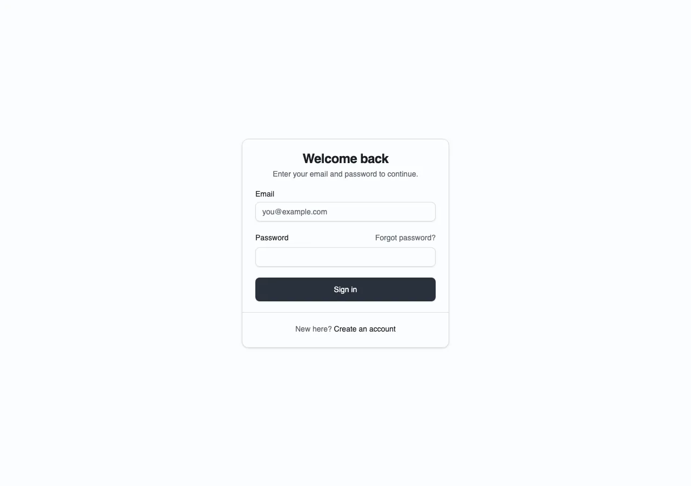
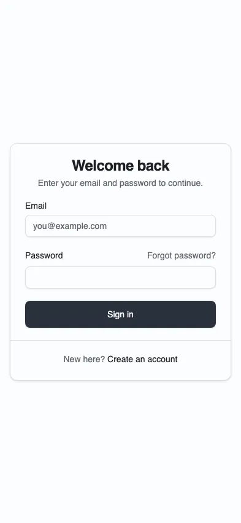

## What it is

Topcoat Blocks is a custom component registry for Topcoat, a server-rendered Rust web framework hosted in the tokio-rs GitHub organisation. Adding a block does not add a dependency to the application: `topcoat ui add sign_in_form --registry topcoat-blocks` copies the block's Rust source and the primitives it needs into the application, where the code becomes the application's own. The repository is the delivery machinery around that idea — a registry crate, a workbench that renders what the registry installs, a review harness, and the retained evidence from the review.

<figure>
  
  <figcaption>The <code>sign_in_form</code> block at desktop width on the light surface, captured by Coatcheck during the review recorded in <code>reviews/sign-in-form/</code>.</figcaption>
</figure>

The problem is the one that follows from copy-in components. A published component library can be versioned and patched; source copied into an application is frozen the moment it lands, so the interesting question becomes whether the copy still renders, still passes an accessibility scan, and still composes with the primitives in the host. Topcoat Blocks answers that with a loop rather than a promise: every block is developed in a real Topcoat host, checked in Coatcheck, and only then offered to the registry.

## How it works

The registry is one TOML file. `crates/topcoat-blocks/registry/registry.toml` declares version 1 and a single component, `sign_in_form`, pointing at `components/sign_in_form.rs` and naming four Topcoat dependencies — button, card, input and label. The crate around it is thin: `src/lib.rs` exports a `REGISTRY_NAME` constant read from the package name, and the manifest's `[package.metadata.topcoat-ui]` key points the CLI at the `registry` directory. The `include` list limits the published package to `registry/**/*.rs`, `registry/**/*.toml` and `src/**/*.rs`, which is where the review harness is kept out.

The block itself is `registry/components/sign_in_form.rs`, 143 lines of Topcoat's `view!` macro. Its parameters are `action`, `forgot_password_href`, `sign_up_href`, `id_prefix`, `attrs` and `child`: the form POSTs `email` and `password` to a host-owned endpoint, the optional links collapse to nothing, `attrs` forwards to the root form so a caller can size it, and the child slot renders first in the body, which is how a CSRF field gets inside the form without the block knowing about CSRF. `id_prefix` exists because two forms on one page would otherwise share label targets.

`apps/workbench` is the host. It builds a Topcoat router with a home page, a frame page, a `/health` route and the Coatcheck manifest route, and it declares two stories in a `&'static [Story]` table — the default form as a playground, and a minimal variant as a state. `scripts/bootstrap` installs the `topcoat` CLI at 0.4.0, then runs `topcoat ui add sign_in_form --registry topcoat-blocks --overwrite` inside the workbench and formats the result, so the workbench genuinely renders registry source rather than a copy maintained by hand.

The gate is `scripts/check`: `cargo fmt --check`, `cargo test --workspace --all-features`, `cargo clippy` with warnings denied, `scripts/release-smoke`, then `coatcheck test`. The smoke script runs `cargo package --list` and fails if the package would contain `apps/`, `coatcheck/`, `Coatcheck.toml`, `package.json`, `scripts/` or `skills/`, and fails the other way if the registry source is missing — the boundary between the published crate and the review harness is a test, not a convention.

<figure>
  
  <figcaption>The same block at mobile width. The review ran ten generated cases — default and minimal forms at mobile, tablet and desktop widths, on the light and dark surfaces.</figcaption>
</figure>

## Run it

`rust-toolchain.toml` pins Rust 1.97.1, the workspace declares `rust-version = "1.95"` and edition 2024, and the review harness needs Bun.

```sh
./scripts/bootstrap
./.tools/bin/coatcheck dev
./scripts/check
```

In a consuming application, the registry arrives as a dependency that carries the source:

```toml
topcoat = { version = "0.4.0", features = ["tailwind", "ui"] }
topcoat-blocks = "0.1.0"
```

```sh
topcoat ui init --theme neutral
topcoat ui add sign_in_form --registry topcoat-blocks
```

## Caveats

There is one block. The roadmap in `docs/roadmap.md` lists sign-up, password recovery and verification-code forms, four shell blocks, four data blocks and four product flows, and fifteen of its sixteen boxes are unchecked; the shell blocks are held back until Topcoat's navigation and overlay primitives settle.

The review evidence is a single date. `reviews/sign-in-form/` records 2026-07-24, ten generated cases, thirteen browser tests passing and zero Axe violations, over one component and one Chromium build. The retained PNGs are selected evidence, and the review note says explicitly that they are not automatic pixel baselines, so nothing here would catch a later visual regression on its own.

The tooling pins exact versions: the workbench depends on `topcoat` 0.4.0 and `coatcheck` 0.2.1 exactly, and `scripts/bootstrap` installs the `topcoat` CLI at 0.4.0 to match, while crates.io serves newer CLI releases. Installing the CLI by hand gets a different version from the one this repository was checked against.
