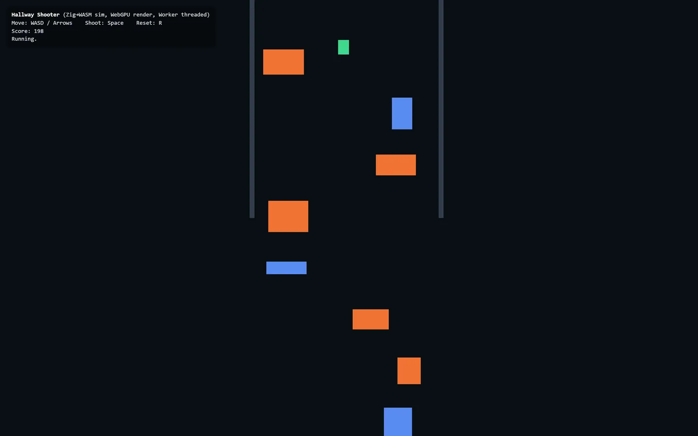
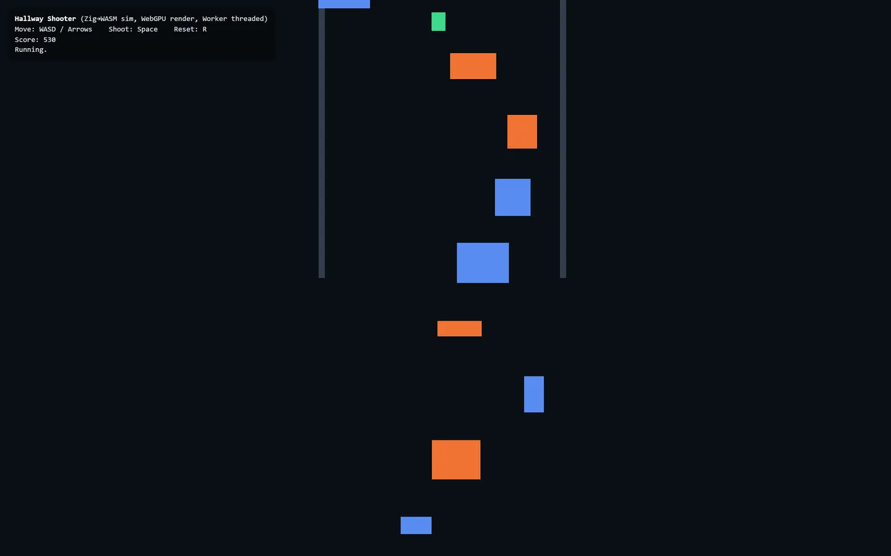

## What it is

A dark browser canvas holding one vertical corridor, 320 units wide and 720 tall. A green box sits near the top of it and the corridor streams up toward that box: orange rectangles and blue swinging rectangles climb the screen while white four-pixel bullets travel down into them. A monospace HUD in the corner prints the score and the keys — WASD or arrows to move, Space to shoot, R to reset — and the rest of the page is empty.

<figure>
  
  <figcaption>The game running: the corridor with the green player box near the top, orange and blue obstacles, and the HUD reading Score 231 about a second into a run. Built from this tree with Zig 0.14.1 into <code>dist/game.wasm</code> and driven in Chromium with a software rasteriser, so these are the module's own rectangles, drawn without a GPU.</figcaption>
</figure>

Three runtimes do the work in sequence. The simulation is a Zig program compiled to a freestanding `wasm32` module, the module runs inside a Web Worker, and the main thread draws whatever the worker last produced with WebGPU, as a single instanced draw over flat quads. The repository is the wiring for that seam rather than a game: nine files, no dependencies, no build system beyond Zig's own and npm's script runner. Its subject is how much of a program can live behind a WebAssembly boundary when there is no runtime on the far side.

## How it works

`zig/src/main.zig` is self-contained. All state is module-level: fixed arrays of 72 obstacles and 48 bullets, and a render buffer of up to 256 rectangles at seven floats each — x, y, width, height, red, green, blue — with an xorshift32 generator seeded by `reset(seed)`. A call to `step(dt_ms, input_mask)` clamps the timestep to 50 ms, advances the player 140 units per second, adds distance travelled to the score, integrates horizontal and screen-vertical velocity with acceleration 1600 and exponential damping, fires a bullet every 0.14 s at 520 units per second, keeps 22 obstacles alive within 1200 units ahead, culls whatever falls 400 units behind, and runs the AABB tests: player against obstacle resets the run with a new seed, bullet against obstacle deactivates both and adds 50 points.

`buildRender()` then rewrites the instance buffer in camera-relative coordinates, and that buffer is the whole interface to the renderer. `zig/build.zig` exports five symbols — `reset`, `step`, `get_render_ptr`, `get_render_len_f32`, `get_score` — and disables the entry point, so the module carries no WASI imports and no start function.

`web/src/sim.worker.js` instantiates `/dist/game.wasm`, calls `step` from a 16 ms interval, copies the frame out of the module's memory into a fresh `Float32Array`, and transfers that buffer to the main thread so it can be read without waiting on the worker. `web/src/main.js` holds the WebGPU side: one pipeline, a six-vertex unit quad, and per-instance attributes for position, size and colour. The vertex shader converts hall pixels to clip space through a uniform holding the canvas size, and the corridor is letterboxed with `min(width / 320, height / 720)`.

<figure>
  
  <figcaption>Twelve seconds later: Score 2822, the corridor still streaming, the player sprite moved up the hall. The score is distance travelled plus fifty for each obstacle destroyed, so most of it is survival; the hall is a fixed viewport and the sprite moves inside it, because the renderer draws flat quads and has no camera to tilt.</figcaption>
</figure>

`server.mjs` is an ordinary static file server. It listens on `127.0.0.1:5173`, refuses paths outside the repository root, sends `.wasm` as `application/wasm`, and sets the cross-origin isolation headers a shared-memory build would need.

## Run it

Zig must be on `PATH` first; the README suggests `brew install zig`. From the repository root:

```bash
npm run build:wasm
npm run serve
```

The first script is `cd zig && zig build -Doptimize=ReleaseSmall --prefix ..`, which writes `dist/game.wasm`. The second is `node server.mjs`. Then open `http://127.0.0.1:5173/web/` in a browser that has WebGPU.

## Caveats

No Zig version is pinned: there is no `build.zig.zon`, and the README asks only for "Zig", with a note that it was not installed on the machine the scaffold was written on, so the release that compiles this `build.zig` is unrecorded. The compiled module is gitignored (`dist/*.wasm`), so a clone cannot be served without a toolchain. The renderer is WebGPU-only — `initWebGPU` throws when `navigator.gpu` is missing and the canvas stays empty.

The README's third architecture, true WebAssembly threads over `SharedArrayBuffer` with several workers updating chunks of physics, is described but not built; the isolation headers in `server.mjs` are set for it in advance, and the file's own comment calls them harmless otherwise. There is no test suite, no licence file, and no recorded output, so the only verification the repository offers is playing it. The README still ends by asking which of the three architectures to build, which dates the scaffold to a conversation rather than a finished game.
